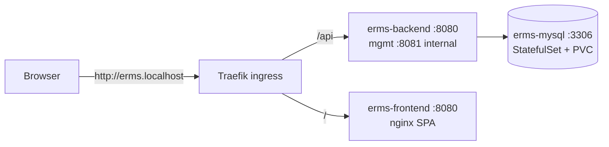
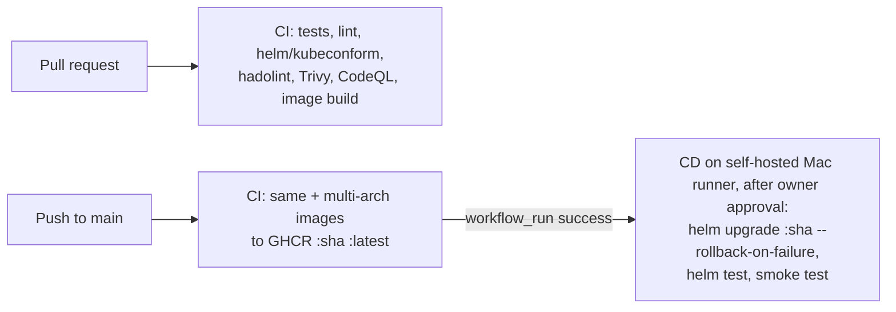

# ERMS: Emergency Resource Management System

[](https://github.com/manojis/CriticalUtilityResponseService/actions/workflows/ci.yml)
[](https://github.com/manojis/CriticalUtilityResponseService/actions/workflows/codeql.yml)

Users register **resources** (equipment and people, classified by FEMA Emergency Support Function), declare **incidents**, search for resources near an incident, and run a **request → deploy → return** workflow.

| Layer | Stack |
|---|---|
| Backend (`backend/`) | Java 21, Spring Boot 4.1, JdbcTemplate, Flyway, Spring Security (stateless JWT), Actuator/Prometheus |
| Frontend (`frontend/`) | Vite, React 19, TypeScript (strict), MUI, served by nginx-unprivileged |
| Database | MySQL 8.4 LTS |
| Platform (`deploy/`, `.github/`, `scripts/`) | Helm chart, GitHub Actions CI (hosted) + CD (self-hosted runner) to Rancher Desktop k3s |

## Architecture



Details: [docs/ARCHITECTURE.md](docs/ARCHITECTURE.md). The documentation index is [docs/README.md](docs/README.md).

```
backend/              Spring Boot API (owns its Dockerfile)
frontend/             React SPA + nginx config (owns its Dockerfile)
deploy/helm/erms/     Helm chart (values.yaml, values-local.yaml)
.github/              CI, CD, CodeQL workflows, Dependabot, PR template
scripts/              setup-local-runner.sh, deploy-local.sh, smoke-test.sh, diagnostics.sh
docs/                 Architecture, API, data model, security, testing, deployment, CI/CD, runbook, ADRs
docker-compose.yml    Local stack without Kubernetes
Makefile              Developer entry points (`make help`)
```

## Quick start

### Option 1: docker compose (no Kubernetes)

Prerequisites: Docker (Rancher Desktop with the moby engine, or Docker Desktop).

```bash
make up                 # = docker compose up --build -d --wait
open http://localhost:3000
make smoke BASE_URL=http://localhost:3000
make down               # keeps the DB volume; `docker compose down -v` wipes it
```

| URL | What |
|---|---|
| http://localhost:3000 | App (nginx proxies `/api` to the backend) |
| http://localhost:8080/api/v1 | API (direct) |
| http://localhost:8080/api/docs | Swagger UI |
| http://localhost:8081/actuator/health | Management port (local only) |

The compose file contains clearly labelled **dev-only** `change-me-…` placeholder secrets. Never reuse them.

### Option 2: Rancher Desktop Kubernetes

Prerequisites: Rancher Desktop with Kubernetes enabled, the **dockerd (moby)** engine and Traefik; `kubectl`, `helm` and `docker` from `~/.rd/bin`.

```bash
kubectl --context rancher-desktop get nodes
make deploy-local       # builds both images, helm upgrade --install, helm test, smoke test
open http://erms.localhost
make status
```

Other deploy paths (a specific GHCR sha, rollback, uninstall): [docs/DEPLOYMENT.md](docs/DEPLOYMENT.md).

### Demo credentials

With the `demo` profile (compose and Rancher Desktop), these users exist, all with the password `password`:

| Username | Type |
|---|---|
| `alice` | Individual |
| `metro_city` | Municipality |
| `fema_atl` | Government agency |
| `acme_rescue` | Company |

## CI/CD



- **CI** (`.github/workflows/ci.yml`) runs on GitHub-hosted runners for every PR and push to `main`. Images are pushed to `ghcr.io/manojis/erms-backend` and `ghcr.io/manojis/erms-frontend` only on push to `main`.
- **CD** (`.github/workflows/cd.yml`) runs only after a successful CI push build on `main` of this repository (or a manual dispatch on `main`). It targets the self-hosted runner labelled `rancher-desktop` under the GitHub environment `local`, which waits for the owner's approval before each deployment.
- **This repository is public.** No `pull_request` workflow ever targets the self-hosted runner. See [docs/CICD.md](docs/CICD.md#public-repository-safeguards-mandatory).

### Self-hosted runner setup (once per Mac)

```bash
gh auth login                       # needs admin rights on the repository
make runner-setup                   # = scripts/setup-local-runner.sh (asks for your password for sudo)
make runner-status                  # make runner-stop / make runner-start
```

The script creates a hidden, unprivileged macOS user `_ermsrunner`, gives it a kubeconfig limited to namespace `erms` and no Docker access, downloads the latest `actions/runner` for osx-arm64 (SHA-256 verified), registers it with the label `rancher-desktop`, runs it as a LaunchDaemon, sets up the `local` environment (deployments from `main` only, your approval required) and applies the public-repository hardening. See [docs/CICD.md](docs/CICD.md#self-hosted-runner-rancher-desktop-host). Remove it with `make runner-uninstall`.

## Common commands

| Command | What it does |
|---|---|
| `make help` | List all targets |
| `make be-test` / `make fe-test` | Backend `./mvnw verify` (Testcontainers) / frontend lint + typecheck + tests |
| `make build` | Backend jar + frontend bundle |
| `make lint` | Spotless, ESLint/Prettier/tsc, helm lint + kubeconform, shellcheck, actionlint, hadolint |
| `make images` | Build both images locally |
| `make up` / `make down` | Compose stack |
| `make deploy-local` / `make smoke` / `make status` | Rancher Desktop deploy, smoke test, status |
| `make runner-setup` / `runner-start` / `runner-stop` / `runner-status` / `runner-uninstall` | Self-hosted runner |

## Documentation

[Architecture](docs/ARCHITECTURE.md) · [Features](docs/FEATURES.md) · [Flows](docs/FLOWS.md) · [API](docs/API.md) · [Data model](docs/DATA_MODEL.md) · [Security](docs/SECURITY.md) · [Testing](docs/TESTING.md) · [Deployment](docs/DEPLOYMENT.md) · [CI/CD](docs/CICD.md) · [Runbook](docs/RUNBOOK.md) · [ADRs](docs/adr/)

## Contributing and security

See [CONTRIBUTING.md](CONTRIBUTING.md) and [CHANGELOG.md](CHANGELOG.md). Report vulnerabilities privately through a GitHub security advisory (Security → Advisories), never in a public issue. See [docs/SECURITY.md](docs/SECURITY.md#reporting-a-vulnerability).
