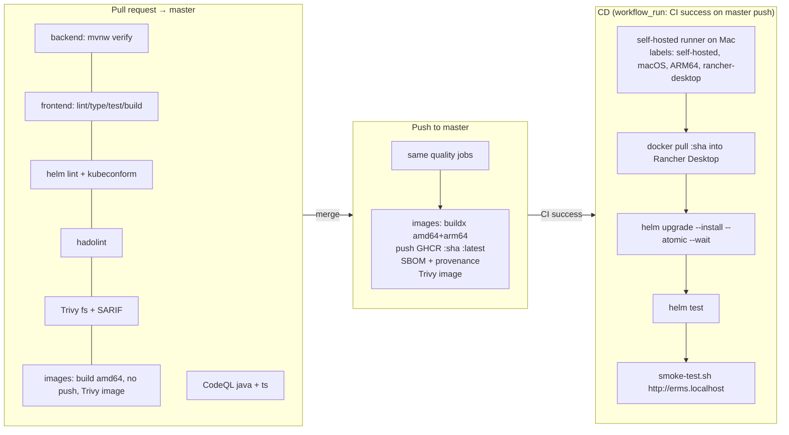

# ERMS CI/CD

Owner: platform developer (WP-PLAT). Design rationale: [ADR-0007](adr/0007-ci-github-hosted-cd-self-hosted.md).

## Pipeline overview

## Workflows
| File | Name | Triggers | Runners | Permissions |
|---|---|---|---|---|
| `.github/workflows/ci.yml` | CI | `pull_request` (master), `push` (master), `workflow_dispatch` | ubuntu-latest | `contents: read` (+ `security-events: write` on security job, `packages: write` on images job) |
| `.github/workflows/cd.yml` | CD | `workflow_run` (CI completed on master), `workflow_dispatch` (`image_tag`) | `[self-hosted, macOS, ARM64, rancher-desktop]` | `contents: read`, `packages: read` |
| `.github/workflows/codeql.yml` | CodeQL | push/PR to master, weekly | ubuntu-latest | `security-events: write` |
| `.github/dependabot.yml` | – | weekly: maven, npm, docker, github-actions | – | – |

Job details are specified in [ARCHITECTURE.md §5.3–5.4](ARCHITECTURE.md#53-ci-githubworkflowsciyml-name-ci).

## Quality gates (a merge needs all green)
backend tests + coverage · frontend lint/typecheck/tests/coverage/build · helm lint + kubeconform · hadolint · Trivy (no CRITICAL) · CodeQL (no new high alerts) · image build.
<!-- PLAT: list exact required status-check names to configure in branch protection for master -->

## Environments
| GitHub Environment | Used by | Protection |
|---|---|---|
| `local` | `cd.yml` → Rancher Desktop | Deployment branches: `master` only. Optional required reviewer |

## Self-hosted runner (Rancher Desktop host)
- Installed by `scripts/setup-local-runner.sh` into `~/actions-runner/erms`, running as a **LaunchAgent** under the user's account (so it can use `~/.rd/docker.sock` and `~/.kube/config`).
- Labels: `self-hosted`, `macOS`, `ARM64` (automatic) + `rancher-desktop`.
- `.path` includes `~/.rd/bin` so `docker`, `kubectl` and `helm` resolve.
- Jobs queue while the Mac sleeps or Rancher Desktop is stopped, and run once it's back.

<!-- PLAT: fill exact commands: install, status (./svc.sh status), logs (~/Library/Logs/actions.runner.*), uninstall -->

### Public-repository safeguards (mandatory)
1. Only `cd.yml` targets the self-hosted runner. Its triggers are `workflow_run` (with `event == 'push'` and the head repository equal to this repo) and `workflow_dispatch` (write access required).
2. No workflow with a `pull_request` or `pull_request_target` trigger may use `runs-on: self-hosted`. QA verifies this, and reviewers must reject PRs that add it.
3. Fork-PR workflows require maintainer approval (repo setting, applied by the setup script).
4. Environment `local` only accepts deployments from `master`.
5. The CD job checks out the exact `head_sha` that CI validated and deploys images by that sha.

## Image tagging & promotion
`<git-sha>` (immutable, deployed) and `latest` (convenience only, never deployed by CD). To promote or roll back, redeploy a sha via `workflow_dispatch` (see [DEPLOYMENT.md → Rollback](DEPLOYMENT.md#rollback)).

## Secrets & tokens
No repository secrets are needed. CI and CD use the job-scoped `GITHUB_TOKEN` for GHCR. Kubernetes secrets are generated in-cluster by Helm ([SECURITY.md](SECURITY.md#secrets-handling)).

## Troubleshooting
| Symptom | Likely cause | Action |
|---|---|---|
| CD job queued forever | Runner offline (Mac asleep, Rancher Desktop stopped) | Start Rancher Desktop; check the runner service status |
| `docker: command not found` in CD | Runner PATH | Re-run the setup script (rewrites `.path`) |
| `helm upgrade` timed out → rolled back | Pod not ready (DB, image, probe) | See [RUNBOOK.md](RUNBOOK.md) diagnostics; the CD job dumps pod events and logs on failure |
| `manifest unknown` on pull | Images job skipped or failed | Check the CI run's images job for that sha |
<!-- PLAT: extend with real issues found during implementation -->
