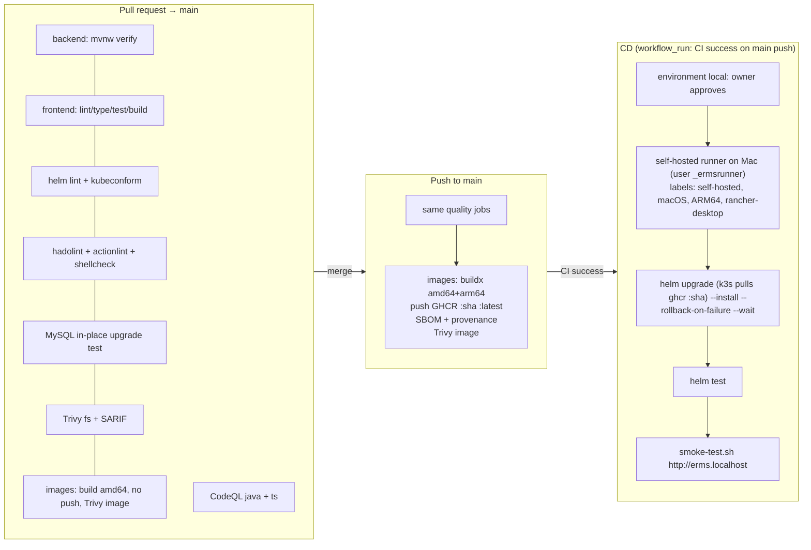

# ERMS CI/CD

Owner: platform developer (WP-PLAT). Design rationale: [ADR-0007](adr/0007-ci-github-hosted-cd-self-hosted.md).

## Pipeline overview



## Workflows
| File | Name | Triggers | Runners | Permissions |
|---|---|---|---|---|
| `.github/workflows/ci.yml` | CI | `pull_request` (main), `push` (main), `workflow_dispatch` | ubuntu-latest | top level `contents: read`; `security-events: write` on `security`; `packages: write` + `security-events: write` on `images` |
| `.github/workflows/cd.yml` | CD | `workflow_run` (CI completed on main), `workflow_dispatch` (`image_tag`, main only) | `[self-hosted, macOS, ARM64, rancher-desktop]` | `contents: read` |
| `.github/workflows/codeql.yml` | CodeQL | push/PR to main, weekly (Mon 04:27 UTC), `workflow_dispatch` | ubuntu-latest | `contents: read`, `security-events: write` |
| `.github/dependabot.yml` | – | weekly (Monday): maven, npm, docker, docker-compose, helm, github-actions; minor/patch grouped | – | – |

CI jobs: `backend` (`./mvnw -B -ntp verify` + reports), `frontend` (`npm ci`, lint, format:check, typecheck, test:coverage, build), `helm` (helm lint `--strict` with local and default values, kubeconform `-strict` against Kubernetes 1.36.0 for the local values and a production-style render), `dockerfiles` (hadolint, threshold `warning`), `infra-lint` (actionlint, shellcheck, and a guard that fails if any workflow combines `self-hosted` with a `pull_request` trigger), `mysql-upgrade` (seeds a volume with the Flyway migrations and demo seed on the MySQL version of the base commit, restarts it on every LTS listed in `MYSQL_UPGRADE_VIA` and then on the new chart version, and checks the version, `CHECK TABLE` and per-table row counts and checksums; it also fails if `docker-compose.yml` or the Testcontainers image differ from the chart; see [RUNBOOK.md](RUNBOOK.md) procedure 14), `security` (Trivy fs: vuln + secret + misconfig, SARIF upload, fails on CRITICAL; accepted findings live in `.trivyignore.yaml`, each scoped to one file with a reason), `images` (matrix backend/frontend; see below), `ci-result` (aggregates everything into one required check).

The `images` job builds `linux/amd64` + `linux/arm64` with buildx and pushes `ghcr.io/manojis/erms-{backend,frontend}:<sha>` and `:latest` with SBOM and provenance attestations **only on push to main**, then Trivy-scans the pushed sha (SARIF + gate on fixable CRITICAL). On pull requests and manual runs it builds `linux/amd64` only (`push: false`, `load: true`) and Trivy-scans the local image.

Every third-party action is pinned to a full commit SHA with a `# vX.Y.Z` comment (the SHAs were resolved with `gh api repos/<owner>/<repo>/git/ref/tags/<tag>`, dereferencing annotated tags). Dependabot updates both the SHA and the comment. Tool images are pinned by version in the workflow `env` (`HELM_VERSION`, `KUBECONFORM_IMAGE`, `ACTIONLINT_IMAGE`, `TRIVY_VERSION`). Job specifications: [ARCHITECTURE.md §5.3–5.4](ARCHITECTURE.md#53-ci-githubworkflowsciyml-name-ci).

## Quality gates (a merge needs all green)
backend tests + coverage · frontend lint/typecheck/tests/coverage/build · helm lint + kubeconform · hadolint · Trivy (no CRITICAL) · CodeQL (no new high alerts) · image build.

Required status checks for `main` (check names as GitHub displays them):

| Check | Workflow |
|---|---|
| `CI result` | CI (aggregates `backend (mvnw verify)`, `frontend (lint, typecheck, test, build)`, `helm lint + kubeconform`, `hadolint`, `actionlint + shellcheck`, `MySQL in-place upgrade`, `Trivy filesystem scan`, `image backend`, `image frontend`) |
| `analyze (java-kotlin)`, `analyze (javascript-typescript)`, `analyze (actions)` | CodeQL |
| `Source branch` | Branch policy (`.github/workflows/branch-policy.yml`) |

### Branch protection (rulesets)
`main` (the default branch, targeted as `~DEFAULT_BRANCH`) is protected by two repository rulesets (Settings → Rules → Rulesets). Branch-protection rules are not used.

| Ruleset | Bypass | Rules |
|---|---|---|
| `main: protection` | **nobody** (not even admins) | PR required (0 approvals; conversations resolved; stale approvals dismissed), squash only; required checks `Source branch`, `CI result`, `analyze (java-kotlin)`, `analyze (javascript-typescript)`, `analyze (actions)` (strict, branch up to date); linear history; no force push; no deletion |
| `main: owner approval and merge` | Repository admin (`@manojis`; personal repos have no other admins), **only through a PR** (`bypass_mode: pull_request`) | Restrict updates: nobody else can merge into `main`. PR needs 1 approval from a code owner (`.github/CODEOWNERS`: `* @manojis`), given after the last push |

Effect:
- Nobody can push to `main` directly; every change is a PR.
- `Source branch` allows only `feat/`, `fix/`, `docs/`, `ci/`, `chore/`, `refactor/`, `test/`, `agent/` and `dependabot/` heads. No one can bypass it.
- GitHub never lets authors approve their own PRs, so the owner merges their own PRs with **Merge without waiting for requirements** (`gh pr merge --squash --admin`). This bypasses only the code-owner ruleset. Everyone else needs `@manojis`'s approval.
- Only `@manojis` can approve (sole code owner) and merge (restrict updates; only the admin bypasses it). Collaborators with write access can open PRs but cannot merge them, even after approval.
- Repository settings: squash merge only, auto-merge allowed, head branches deleted after merge.

Inspect: `gh api repos/manojis/CriticalUtilityResponseService/rulesets`. To change the required checks, edit the ruleset in the UI or `gh api -X PUT repos/manojis/CriticalUtilityResponseService/rulesets/<id>` with the full rule list. A new check name only becomes selectable after it has run once.

## Environments
| GitHub Environment | Used by | Protection |
|---|---|---|
| `local` | `cd.yml` → Rancher Desktop | Deployment branches: `main` only. Required reviewer: `@manojis` (self-review allowed), so every deployment waits for **Review deployments → Approve and deploy** in the run (or `gh api` below) |

## Self-hosted runner (Rancher Desktop host)
The runner is isolated from your account. A malicious job could only reach what the runner user can reach:

| Layer | Setting |
|---|---|
| macOS user | Hidden role account `_ermsrunner` (uid 450–499, no password, shell `/usr/bin/false`, not an admin). It cannot read `/Users/<you>` (mode 750) |
| Service | System **LaunchDaemon** `dev.erms.actions-runner` (`/Library/LaunchDaemons`, `UserName=_ermsrunner`). Runs without anyone logged in; `make runner-stop` disables it across reboots |
| Files | `/opt/erms-runner/bin` (root-owned `kubectl` + `helm`), `/opt/erms-runner/runner` and `/opt/erms-runner/home` (mode 700, runner only), logs in `/Library/Logs/erms-runner` |
| Docker | **No access** to `~/.rd/docker.sock` (that socket is root-equivalent in the Rancher VM). k3s pulls the public GHCR images by sha |
| Kubernetes | kubeconfig for the ServiceAccount `erms/erms-deployer` ([deploy/runner/deployer-rbac.yaml](../deploy/runner/deployer-rbac.yaml)): manage the chart's resources in namespace `erms` only. No nodes, namespaces, RBAC, `pods/exec` or other namespaces. The script verifies this with `kubectl auth can-i` |
| GitHub | Environment `local`: deployments from `main` only, and each waits for the owner's approval |

Labels: `self-hosted`, `macOS`, `ARM64` (automatic) + `rancher-desktop`. Jobs queue while the runner is stopped, the Mac sleeps or Rancher Desktop is down, and run once it's back (queued jobs expire after 24 h).

Install (idempotent; re-run it any time to repair). Run it as yourself; it asks for your password for the `sudo` steps:
```bash
gh auth login                      # admin on manojis/CriticalUtilityResponseService
make runner-setup                  # = scripts/setup-local-runner.sh [--repo owner/name] [--name NAME]
```
What it does, in order: preflight (macOS arm64, `gh` + repo admin, `kubectl`/`helm`, context `rancher-desktop` reachable, `sudo -v`) → creates `_ermsrunner` with `dscl` (if missing) and the directories → installs `kubectl` matching the cluster version from `dl.k8s.io` (SHA-256 verified) and copies Rancher Desktop's `helm` into `/opt/erms-runner/bin` → `kubectl apply -f deploy/runner/deployer-rbac.yaml` (namespace with Pod Security `restricted`, ServiceAccount, Role, RoleBinding, token Secret) and writes the runner's kubeconfig (context `rancher-desktop`, mode 600) → downloads the latest `actions/runner` osx-arm64 tarball, verifies its SHA-256 against the release notes (cross-checked with GitHub's asset digest) and extracts it as `_ermsrunner` → registers with `config.sh --unattended --replace --labels rancher-desktop --name <LocalHostName>-rancher-desktop` using a short-lived registration token (skipped if already registered) → writes `.path`/`.env` → installs and starts the LaunchDaemon → hardening (below). `--skip-hardening` skips the repository settings.

Operate:
```bash
make runner-status                 # launchd state + GitHub online/busy
make runner-stop                   # stop now and stay off across reboots (sudo)
make runner-start                  # enable and start again (sudo)
sudo tail -n 50 /Library/Logs/erms-runner/stderr.log
sudo sh -c 'tail -n 100 /opt/erms-runner/runner/_diag/Runner_*.log'   # job logs: _diag/Worker_*.log
```

Approve a waiting deployment from the terminal (or click **Review deployments** in the run):
```bash
RUN=$(gh run list --workflow cd.yml --status waiting -L1 --json databaseId -q '.[0].databaseId')
ENV_ID=$(gh api repos/manojis/CriticalUtilityResponseService/environments/local -q .id)
gh api -X POST repos/manojis/CriticalUtilityResponseService/actions/runs/$RUN/pending_deployments \
  -F "environment_ids[]=$ENV_ID" -f state=approved -f comment="deploy"
```

Uninstall (removes the LaunchDaemon, unregisters the runner, deletes `/opt/erms-runner`, the logs, the `_ermsrunner` user and the ServiceAccount/RBAC; the app in namespace `erms` is left running):
```bash
make runner-uninstall              # = scripts/setup-local-runner.sh --uninstall
```

### Public-repository safeguards (mandatory)
1. Only `cd.yml` targets the self-hosted runner. Its triggers are `workflow_run` (with `event == 'push'` and the head repository equal to this repo) and `workflow_dispatch` (write access required).
2. No workflow with a `pull_request` or `pull_request_target` trigger may use `runs-on: self-hosted`. QA verifies this, and reviewers must reject PRs that add it.
3. Fork-PR workflows require maintainer approval for **all external contributors** (`fork-pr-contributor-approval` = `all_external_contributors`, applied by the setup script). The script also sets the default `GITHUB_TOKEN` to read-only, stops workflows from approving PRs, and enables secret scanning with push protection.
4. Environment `local` only accepts deployments from `main` (custom deployment branch policy), and the repository owner must approve each deployment (required reviewer). Both are applied by the setup script.
5. The CD job checks out the exact `head_sha` that CI validated and deploys images by that sha. A manual `image_tag` is validated against `^[A-Za-z0-9][A-Za-z0-9_.-]{0,127}$` and passed through `env`, never interpolated into scripts.
6. CI enforces rule 2 automatically (the `infra-lint` job's self-hosted guard). Checkouts use `persist-credentials: false`.
7. The runner is an unprivileged macOS user without the docker socket and with a namespace-scoped kubeconfig (see the table above), so even an approved job that misbehaves cannot read your files or administer the cluster.

## Image tagging & promotion
`<git-sha>` (immutable, deployed) and `latest` (convenience only, never deployed by CD). To promote or roll back, redeploy a sha via `workflow_dispatch` (see [DEPLOYMENT.md → Rollback](DEPLOYMENT.md#rollback)).

## Secrets & tokens
No repository secrets are needed. CI uses the job-scoped `GITHUB_TOKEN` to push to GHCR. The packages `erms-backend` and `erms-frontend` are **public**, so k3s pulls them anonymously and CD needs no registry credentials. Kubernetes secrets are generated in-cluster by Helm ([SECURITY.md](SECURITY.md#secrets-handling)).

## Troubleshooting
| Symptom | Likely cause | Action |
|---|---|---|
| CD job `Waiting` | Environment `local` needs your approval | Click **Review deployments** in the run, or use the `gh api` command above |
| CD job queued forever | Runner stopped or offline (Mac asleep, Rancher Desktop stopped) | `make runner-status`; `make runner-start`; start Rancher Desktop |
| `kubectl`/`helm: command not found` in CD | Runner PATH | Re-run `make runner-setup` (rewrites `.path`) |
| Preflight: `runner identity cannot deploy` | ServiceAccount, token or namespace deleted (e.g. Rancher Desktop reset) | Re-run `make runner-setup` |
| `helm upgrade` timed out → rolled back | Pod not ready (DB, image, probe) | See [RUNBOOK.md](RUNBOOK.md) diagnostics; the CD job dumps pod events and logs on failure |
| `manifest unknown` on pull | Images job skipped or failed | Check the CI run's images job for that sha |
| `Flag --atomic has been deprecated` | Helm 4 renamed the flag | Use `--rollback-on-failure` (scripts and CD detect the Helm major version) |
| `ImagePullBackOff` (`denied`/`unauthorized`) | A GHCR package is private | Package settings → Change visibility → Public |
| `upload-sarif` fails on a fork PR | Fork PR tokens are read-only | Expected; the upload step is skipped for fork PRs |
| actionlint: `label "rancher-desktop" is unknown` | Custom runner label | Declared in `.github/actionlint.yaml` |
| `$K get pods` fails in zsh with "command not found" | zsh doesn't word-split variables | Use the `k()` function from [RUNBOOK.md](RUNBOOK.md) |
| `kubectl run` rejected: `violates PodSecurity "restricted"` | Namespace `erms` enforces Pod Security `restricted` | Give the pod a restricted securityContext (RUNBOOK procedure 13) |
| CodeQL: "default setup is enabled" error | Repository default setup conflicts with `codeql.yml` | Settings → Code security → CodeQL → switch to Advanced (currently not configured) |
