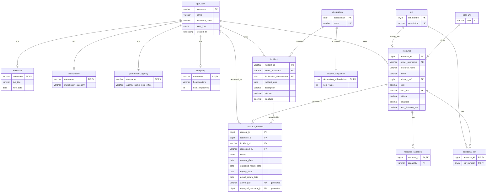

# ERMS Data Model

MySQL 8.4 LTS. The schema is owned by Flyway (`backend/src/main/resources/db/migration`). The authoritative DDL is `V1__schema.sql`; its design is reproduced in [ARCHITECTURE.md §3.9](ARCHITECTURE.md#39-database-flyway-migrations). Owner: backend developer (WP-BE). Any migration updates this file in the same PR.

Conventions: InnoDB, `utf8mb4` / `utf8mb4_0900_ai_ci` (case-insensitive comparisons and `LIKE`), snake_case names, `fk_`/`uq_`/`ck_`/`ix_` constraint prefixes, all dates are `DATE` (no time-of-day), audit timestamps are `TIMESTAMP` in UTC. Migrations are forward-only. **Never edit an applied versioned migration**; add `V<n+1>__…sql` instead.

## Entity-relationship diagram

## Data dictionary

### app_user
| Column | Type | Null | Notes |
|---|---|---|---|
| username | VARCHAR(50) | N | PK. Login name and JWT `sub` |
| name | VARCHAR(100) | N | Display name |
| password_hash | VARCHAR(100) | N | BCrypt (`$2a$10$…`). Never returned by the API or logged |
| user_type | ENUM | N | `INDIVIDUAL`, `MUNICIPALITY`, `GOVERNMENT_AGENCY`, `COMPANY`. Exactly one matching subtype row is expected |
| created_at | TIMESTAMP | N | default now |

### Subtypes (1:1 with app_user, `ON DELETE CASCADE`)
| Table | Columns |
|---|---|
| individual | `job_title VARCHAR(100) NOT NULL`, `hire_date DATE NOT NULL` |
| municipality | `municipality_category VARCHAR(100) NOT NULL` (e.g. City, County, Town) |
| government_agency | `agency_name_local_office VARCHAR(150) NOT NULL` |
| company | `headquarters VARCHAR(150) NOT NULL`, `num_employees INT UNSIGNED NOT NULL` |

### esf / cost_unit / declaration (reference data, `V2__reference_data.sql`)
| Table | Columns |
|---|---|
| esf | `esf_number TINYINT UNSIGNED` PK, `description VARCHAR(120)` unique |
| cost_unit | `unit VARCHAR(20)` PK |
| declaration | `abbreviation CHAR(2)` PK, `name VARCHAR(100)` unique |
| incident_sequence | `declaration_abbreviation CHAR(2)` PK/FK, `next_value INT UNSIGNED` (next number to hand out) |

### incident
| Column | Type | Null | Notes |
|---|---|---|---|
| incident_id | VARCHAR(16) | N | PK, format `<ABBR>-<n>`, server-generated (see below) |
| owner_username | VARCHAR(50) | N | FK app_user. Indexed |
| declaration_abbreviation | CHAR(2) | N | FK declaration |
| incident_date | DATE | N | ≤ today (enforced in the service) |
| description | VARCHAR(500) | N | 6–500 chars (enforced in the service) |
| latitude / longitude | DECIMAL(9,6) | N | CHECK ±90 / ±180 |
| created_at | TIMESTAMP | N | |

### resource
| Column | Type | Null | Notes |
|---|---|---|---|
| resource_id | BIGINT UNSIGNED AI | N | PK |
| owner_username | VARCHAR(50) | N | FK app_user. Indexed |
| resource_name | VARCHAR(100) | N | Indexed. Keyword search |
| model | VARCHAR(100) | Y | Keyword search |
| primary_esf | TINYINT UNSIGNED | N | FK esf. Indexed |
| cost | DECIMAL(12,2) | N | CHECK ≥ 0 |
| cost_unit | VARCHAR(20) | N | FK cost_unit |
| latitude / longitude | DECIMAL(9,6) | N | CHECK ±90 / ±180 |
| max_distance_km | DECIMAL(8,2) | Y | NULL = no limit. CHECK > 0 |
| created_at | TIMESTAMP | N | |

There's no `is_available`/`next_available` column. Availability is **derived** from `resource_request` (see below).

### resource_capability / additional_esf
| Table | PK | Notes |
|---|---|---|
| resource_capability | (resource_id, capability) | `capability VARCHAR(100)`, indexed. Keyword search via `EXISTS` |
| additional_esf | (resource_id, esf_number) | Must not equal the resource's primary ESF (enforced in the service). ESF search via `EXISTS` |

### resource_request
| Column | Type | Null | Notes |
|---|---|---|---|
| request_id | BIGINT UNSIGNED AI | N | PK |
| resource_id | BIGINT UNSIGNED | N | FK resource (RESTRICT) |
| incident_id | VARCHAR(16) | N | FK incident (RESTRICT) |
| requested_by | VARCHAR(50) | N | FK app_user. Always equals the incident owner |
| status | ENUM | N | `PENDING`, `DEPLOYED`, `REJECTED`, `CANCELLED`, `RETURNED` |
| request_date | DATE | N | set by the server on create |
| expected_return_date | DATE | N | ≥ request_date (CHECK) |
| deploy_date | DATE | Y | set on deploy |
| actual_return_date | DATE | Y | set on return |
| created_at / updated_at | TIMESTAMP | N | audit |
| active_pair | VARCHAR(40) STORED GENERATED | Y | `resource_id:incident_id` while PENDING/DEPLOYED, else NULL. **UNIQUE** → at most one active request per (resource, incident) |
| deployed_resource_id | BIGINT STORED GENERATED | Y | `resource_id` while DEPLOYED, else NULL. **UNIQUE** → a resource is deployed to at most one incident |

Indexes: `(requested_by, status)`, `(resource_id, status)`.

## Derived values
| Value | Definition |
|---|---|
| `available` | `NOT EXISTS (resource_request WHERE resource_id = r.resource_id AND status = 'DEPLOYED')` |
| `nextAvailableDate` | `expected_return_date` of the DEPLOYED request, else `null` |
| `distanceKm` | `ST_Distance_Sphere(POINT(r.longitude, r.latitude), POINT(i.longitude, i.latitude)) / 1000`, rounded to 0.1 |
| `resourcesInUse` (report) | count of the caller's resources (by primary ESF) with a DEPLOYED request |

## Incident ID generation
In one transaction: `SELECT next_value … FOR UPDATE` on the declaration's `incident_sequence` row → id = `ABBR-next_value` → increment → insert the incident. The row lock serialises concurrent creates per declaration, so there are no duplicates. A rolled-back insert can leave a gap, which is acceptable.

## Reference data (V2)
**ESF:** 1 Transportation · 2 Communications · 3 Public Works and Engineering · 4 Firefighting · 5 Information and Planning · 6 Mass Care, Emergency Assistance, Temporary Housing, and Human Services · 7 Logistics · 8 Public Health and Medical Services · 9 Search and Rescue · 10 Oil and Hazardous Materials Response · 11 Agriculture and Natural Resources · 12 Energy · 13 Public Safety and Security · 14 Cross-Sector Business and Infrastructure · 15 External Affairs

**Cost units:** Each, Hour, Day, Week

**Declarations:** MD Major Disaster · ED Emergency · FM Fire Management Assistance · FD Federal Department

## Demo seed (profile `demo` only: `db/seed/R__demo_seed.sql`)
Password for all users: `password`.

| username | type | profile |
|---|---|---|
| alice | INDIVIDUAL | Emergency Coordinator, hired 2015-03-01 |
| metro_city | MUNICIPALITY | City |
| fema_atl | GOVERNMENT_AGENCY | FEMA Region IV - Atlanta |
| acme_rescue | COMPANY | HQ Atlanta, GA · 250 employees |

Plus about 6 resources (ids 1001+) around Atlanta, spread across owners and ESFs, and incident `MD-1` owned by alice at (33.749, −84.388). The seed is idempotent (`ON DUPLICATE KEY UPDATE`) and must never be enabled in production.
