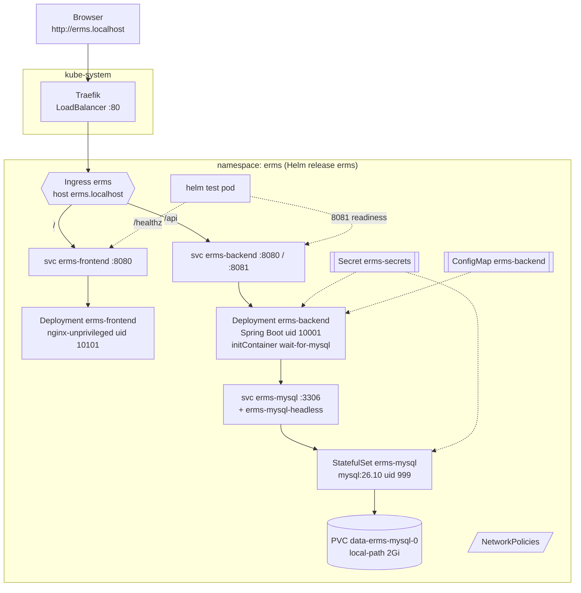

# ERMS Deployment

Owner: platform developer (WP-PLAT). Target: Rancher Desktop with k3s v1.36.6, Helm v4.3.1 and kubectl v1.37 on macOS arm64. The prerequisite checks were run as written; the chart was validated with `helm lint`, kubeconform and a server-side dry-run (`kubectl apply --dry-run=server`) on that cluster.

> **Helm 4 note:** Helm 4 renamed `--atomic` to `--rollback-on-failure` (same behaviour; `--atomic` still works but prints a deprecation warning). The scripts and `cd.yml` pick the right flag automatically. With Helm 3 use `--atomic` wherever this page says `--rollback-on-failure`.

## Environments
| Environment | Where | How deployed | Data | Profile |
|---|---|---|---|---|
| Dev (compose) | Developer laptop, Docker | `docker compose up --build` | Named volume, demo seed | `demo` |
| Local (k8s) | Rancher Desktop k3s, context `rancher-desktop`, namespace `erms` | GitHub Actions `cd.yml` on the self-hosted runner, or `make deploy-local` | PVC (local-path), demo seed | `demo` |
| Production (future) | Any conformant k8s | Same chart with prod values: external DB via `existingSecret`, TLS ingress, replicas ≥ 2, HPA/PDB on | Managed MySQL | none |

## Kubernetes topology



## Images
| Image | Registry path | Tags | Platforms |
|---|---|---|---|
| backend | `ghcr.io/manojis/erms-backend` | `<git-sha>`, `latest` (main only) | linux/amd64, linux/arm64 |
| frontend | `ghcr.io/manojis/erms-frontend` | `<git-sha>`, `latest` | linux/amd64, linux/arm64 |

Deployments always use the immutable `<git-sha>` tag (the full 40-character commit sha). The GHCR packages are **public**, so k3s pulls the sha images itself and no pull secret is needed; the CD runner has no docker access at all. Rancher Desktop runs the **moby** engine, which shares its image store with k3s, so images built by `make deploy-local` are used directly (`imagePullPolicy: IfNotPresent`).

## Prerequisites (Rancher Desktop)
1. Rancher Desktop with **Kubernetes enabled**, container engine **dockerd (moby)**, Traefik enabled.
2. CLIs: `kubectl`, `helm` (bundled at `~/.rd/bin`), `docker`, `gh`.
3. `erms.localhost` resolves to 127.0.0.1. Browsers and curl handle `*.localhost` natively. If a tool doesn't, add `127.0.0.1 erms.localhost` to `/etc/hosts`.

Verify the prerequisites:

```bash
export PATH="$HOME/.rd/bin:$PATH"
rdctl list-settings | jq '{engine: .containerEngine.name, kubernetes: .kubernetes.enabled, version: .kubernetes.version, traefik: .kubernetes.options.traefik}'
# expect: "engine": "moby", "kubernetes": true, "traefik": true
docker context show                                   # rancher-desktop
kubectl --context rancher-desktop get nodes           # 1 node, Ready
kubectl --context rancher-desktop get ingressclass traefik
kubectl --context rancher-desktop get storageclass local-path
helm version --short                                  # v4.x (v3.x also works)
curl -s -o /dev/null -w '%{http_code}\n' http://erms.localhost/   # 404 from Traefik before the first deploy
```

## Deploy paths
### A. Automatic (CI/CD)
Merge to `main` → CI builds, tests, scans and pushes images → CD deploys to Rancher Desktop. See [CICD.md](CICD.md).

### B. Manual from a checkout
```bash
make deploy-local
# = scripts/deploy-local.sh --context rancher-desktop --namespace erms
```

`scripts/deploy-local.sh`:
1. checks docker, kubectl (context `rancher-desktop`) and helm;
2. builds `ghcr.io/manojis/erms-backend:<tag>` and `ghcr.io/manojis/erms-frontend:<tag>` with `docker build` straight into the moby store that k3s uses. `<tag>` is `local-<short sha>`, plus `-dirty-<epoch>` when `backend/` or `frontend/` have uncommitted changes, so the pods always roll;
3. creates namespace `erms` with the label `pod-security.kubernetes.io/enforce=restricted`;
4. runs `helm upgrade --install … -f values-local.yaml --set backend.image.tag=<tag> --set frontend.image.tag=<tag> --rollback-on-failure --wait --timeout 10m`;
5. runs `helm test erms --logs`, then `scripts/smoke-test.sh http://erms.localhost`;
6. on any failure, prints diagnostics (`scripts/diagnostics.sh`: release status, pods, events, describe, logs).

Options: `--tag TAG`, `--no-build` (use images already in the local store), `--skip-test`, `--skip-smoke`, `--timeout 15m`. Run `scripts/deploy-local.sh --help` for the full list.

### C. Specific version from GHCR
Any sha that CI pushed (see the Packages tab or the CI run). The packages are public, so k3s pulls them directly; the preferred way is `gh workflow run cd.yml -f image_tag=<sha>` (then approve the deployment).

```bash
SHA=<full git sha>
helm upgrade --install erms deploy/helm/erms --kube-context rancher-desktop -n erms --create-namespace \
  -f deploy/helm/erms/values-local.yaml \
  --set backend.image.tag=$SHA --set frontend.image.tag=$SHA \
  --rollback-on-failure --wait --timeout 10m
helm test erms -n erms --kube-context rancher-desktop --logs
scripts/smoke-test.sh http://erms.localhost
```

Equivalent shortcut once the images are pulled: `scripts/deploy-local.sh --no-build --tag $SHA`. Through GitHub instead: run the **CD** workflow manually on `main` with `image_tag=$SHA` (`gh workflow run cd.yml --ref main -f image_tag=$SHA`).

### D. docker-compose (no Kubernetes)
```bash
make up                  # = docker compose up --build -d --wait
docker compose ps        # mysql, backend, frontend: healthy
make smoke BASE_URL=http://localhost:3000
make logs                # follow logs
make down                # stop; the mysql-data volume is kept
docker compose down -v   # stop and wipe the database
```

App at http://localhost:3000 (nginx proxies `/api` to the backend), API at http://localhost:8080/api/v1, Swagger at http://localhost:8080/api/docs, actuator at http://localhost:8081/actuator/health. Ports are bound to `127.0.0.1` only. Override the MySQL host port with `MYSQL_HOST_PORT=3307 make up`. The compose file uses **dev-only** `change-me-…` placeholder secrets.

## Configuration (Helm values)
Full list with comments: [`deploy/helm/erms/values.yaml`](../deploy/helm/erms/values.yaml). Values are validated by `values.schema.json`.

| Value | Default | Local override (`values-local.yaml`) | Meaning |
|---|---|---|---|
| `imageRegistry` | `ghcr.io/manojis` | | Registry prefix for the backend/frontend images |
| `backend.image.tag` / `frontend.image.tag` | `""` → falls back to the chart `appVersion` | set by CD / `deploy-local.sh` | Image tag (git sha) |
| `backend.image.pullPolicy` / `frontend.image.pullPolicy` | `IfNotPresent` | | Images come from the shared moby store; no pull secret |
| `backend.profiles` | `""` | `demo` | `SPRING_PROFILES_ACTIVE` (demo = seed data) |
| `backend.apiDocsEnabled` | `false` | `true` | `ERMS_API_DOCS_ENABLED`: Swagger at `/api/docs` |
| `backend.corsAllowedOrigins` | `""` | | `ERMS_CORS_ALLOWED_ORIGINS` (empty = CORS off) |
| `backend.jwt.ttl` / `backend.jwt.issuer` | `PT1H` / `erms` | | `ERMS_JWT_TTL` / `ERMS_JWT_ISSUER` |
| `backend.timeZone` | `UTC` | | `ERMS_TIME_ZONE` |
| `backend.datasource.url` / `.username` | `""` (in-chart MySQL) / `""` (= `mysql.username`) | | JDBC URL override for an external DB |
| `backend.extraEnv` | `[]` | | Extra env vars for the backend container |
| `backend.replicas` / `frontend.replicas` | 1 | | A PDB (`minAvailable: 1`) is rendered automatically when > 1 |
| `backend.autoscaling.enabled` / `frontend.autoscaling.enabled` | `false` | | HPA (CPU 75%, 2–4 replicas); also renders the PDB |
| `backend.resources` | req 250m / 512Mi, limit 2 CPU / 1Gi | | |
| `frontend.resources` | req 50m / 64Mi, limit 500m / 128Mi | | |
| `mysql.enabled` | `true` | | In-chart MySQL StatefulSet |
| `mysql.image.tag` | `26.10.0.1` | | Official `mysql` image |
| `mysql.database` / `mysql.username` | `erms` / `erms` | | |
| `mysql.readOnlyRootFilesystem` | `true` | | emptyDirs for `/var/run/mysqld` and `/tmp` |
| `mysql.storage.size` / `mysql.storage.storageClass` | `2Gi` / `""` (cluster default) | `local-path` | PVC `data-erms-mysql-0` |
| `mysql.resources` | req 250m / 512Mi, limit 1 CPU / 1Gi | | |
| `waitForDb.image.tag` | `busybox:1.38.0` | | initContainer that waits for `erms-mysql:3306` |
| `secrets.existingSecret` | `""` | | Use a pre-created secret (keys `mysql-root-password`, `mysql-password`, `jwt-secret`) instead of the chart-managed `erms-secrets` |
| `ingress.enabled` / `ingress.className` / `ingress.host` | `true` / `traefik` / `erms.localhost` | | Ingress (`/api` → backend:8080, `/` → frontend:8080) |
| `ingress.annotations` / `ingress.tls` | `{}` / `[]` | | e.g. cert-manager annotations and TLS secret for production |
| `networkPolicy.enabled` | `true` | | NetworkPolicies |
| `networkPolicy.ingressControllerNamespace` | `kube-system` | | Namespace of the Traefik pods |
| `serviceAccount.create` / `serviceAccount.name` | `true` / `""` | | Token automount is always off |
| `tests.image.tag` | `curlimages/curl:8.23.0` | | `helm test` pod |
| `*.nodeSelector` / `*.tolerations` / `*.affinity`, `*.podAnnotations` | empty | | Scheduling and annotations per component |

**Production sketch** (not used locally): `mysql.enabled=false`, `backend.datasource.url=jdbc:mysql://<managed-db>:3306/erms?…`, `secrets.existingSecret=<secret>`, `backend.replicas=2` (PDB on), `ingress.host=<fqdn>` + `ingress.tls`, `backend.profiles=""`.

## Rollback
- **Automatic**: `--rollback-on-failure` (Helm 3: `--atomic`) rolls back a failed upgrade (pods not ready within the timeout).
- **Manual**:
  ```bash
  helm history erms -n erms --kube-context rancher-desktop
  helm rollback erms <REVISION> -n erms --kube-context rancher-desktop --wait --timeout 10m
  helm test erms -n erms --kube-context rancher-desktop --logs
  ```
  The sha images of the older revision must still be in the local image store (`docker images ghcr.io/manojis/erms-backend`); pull them first if they were pruned.
- **Re-deploy an older build**: run the CD workflow manually with `image_tag=<older sha>`: `gh workflow run cd.yml --ref main -f image_tag=<older sha>`. CD uses the chart from the current `main` with the older images.
- **DB caveat**: Flyway migrations are forward-only. Rolling back the app across a migration requires that migration to be backward-compatible (expand/contract). Never drop or rename columns in the same release that stops using them.

## Uninstall
```bash
helm uninstall erms -n erms --kube-context rancher-desktop --wait     # or: make undeploy-local
```

This removes the Deployments, StatefulSet, Services, Ingress, ConfigMap and NetworkPolicies. Two things **survive on purpose**, so a re-install keeps the data and the matching passwords:
- Secret `erms-secrets` (`helm.sh/resource-policy: keep`). A later `helm upgrade --install` adopts it again.
- PVC `data-erms-mysql-0` (StatefulSet PVCs are never deleted by Helm).

To wipe everything (all data is lost; delete both together, because a new password doesn't match an old data directory):

```bash
kubectl --context rancher-desktop -n erms delete pvc data-erms-mysql-0
kubectl --context rancher-desktop -n erms delete secret erms-secrets
kubectl --context rancher-desktop delete namespace erms
```
