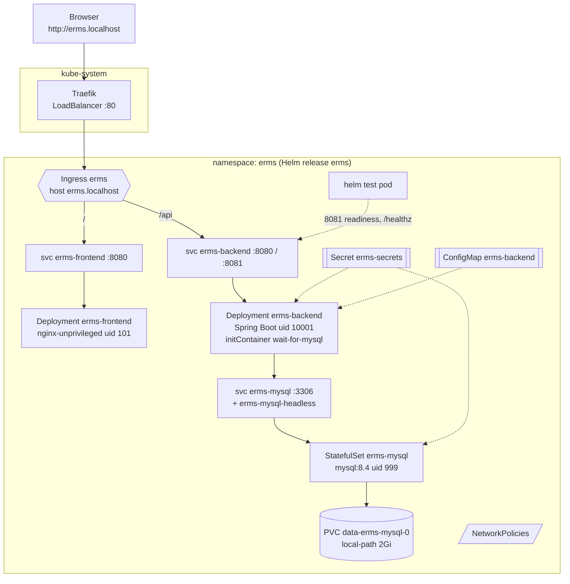

# ERMS Deployment

Owner: platform developer (WP-PLAT). Sections marked `<!-- PLAT: … -->` must be filled in with the exact, tested commands once implementation is done.

## Environments
| Environment | Where | How deployed | Data | Profile |
|---|---|---|---|---|
| Dev (compose) | Developer laptop, Docker | `docker compose up --build` | Named volume, demo seed | `demo` |
| Local (k8s) | Rancher Desktop k3s, context `rancher-desktop`, namespace `erms` | GitHub Actions `cd.yml` on the self-hosted runner, or `make deploy-local` | PVC (local-path), demo seed | `demo` |
| Production (future) | Any conformant k8s | Same chart with prod values: external DB via `existingSecret`, TLS ingress, replicas ≥ 2, HPA/PDB on | Managed MySQL | none |

## Kubernetes topology

## Images
| Image | Registry path | Tags | Platforms |
|---|---|---|---|
| backend | `ghcr.io/manojis/erms-backend` | `<git-sha>`, `latest` (master only) | linux/amd64, linux/arm64 |
| frontend | `ghcr.io/manojis/erms-frontend` | `<git-sha>`, `latest` | linux/amd64, linux/arm64 |

Deployments always use the immutable `<git-sha>` tag. Rancher Desktop runs the **moby** engine, which shares its image store with k3s. The CD job runs `docker pull` on the sha tag, and the pods start with `imagePullPolicy: IfNotPresent`, so no pull secret is needed in the cluster.

## Prerequisites (Rancher Desktop)
1. Rancher Desktop with **Kubernetes enabled**, container engine **dockerd (moby)**, Traefik enabled.
2. CLIs: `kubectl`, `helm` (bundled at `~/.rd/bin`), `docker`, `gh`.
3. `erms.localhost` resolves to 127.0.0.1. Browsers and curl handle `*.localhost` natively. If a tool doesn't, add `127.0.0.1 erms.localhost` to `/etc/hosts`.

<!-- PLAT: fill exact commands to verify prerequisites (rdctl list-settings, kubectl --context rancher-desktop get nodes) -->

## Deploy paths
### A. Automatic (CI/CD)
Merge to `master` → CI builds, tests, scans and pushes images → CD deploys to Rancher Desktop. See [CICD.md](CICD.md).

### B. Manual from a checkout
<!-- PLAT: fill exact commands, e.g. `make deploy-local` (builds images locally, helm upgrade --install, smoke test) -->

### C. Specific version from GHCR
<!-- PLAT: fill exact commands: docker pull …:<sha>; helm upgrade --install erms deploy/helm/erms --kube-context rancher-desktop -n erms --create-namespace -f deploy/helm/erms/values-local.yaml --set backend.image.tag=<sha> --set frontend.image.tag=<sha> --atomic --wait --timeout 10m -->

### D. docker-compose (no Kubernetes)
<!-- PLAT: fill exact commands; app at http://localhost:3000, API at http://localhost:8080, Swagger at http://localhost:8080/api/docs -->

## Configuration (Helm values)
| Value | Default | Local override | Meaning |
|---|---|---|---|
| `imageRegistry` | `ghcr.io/manojis` | | Registry prefix |
| `backend.image.tag` / `frontend.image.tag` | `""` (required) | set by CD to the git sha | Image tag |
| `backend.profiles` | `""` | `demo` | `SPRING_PROFILES_ACTIVE` (demo = seed data) |
| `backend.apiDocsEnabled` | `false` | `true` | Swagger at `/api/docs` |
| `backend.corsAllowedOrigins` | `""` | | CORS allow-list |
| `backend.replicas` / `frontend.replicas` | 1 | | PDB enabled automatically when > 1 |
| `mysql.storage.size` / `storageClass` | 2Gi / `""` | `local-path` | PVC |
| `secrets.existingSecret` | `""` | | Use a pre-created secret instead of the chart-managed one |
| `ingress.host` / `className` | `erms.localhost` / `traefik` | | Ingress |
| `networkPolicy.enabled` | `true` | | NetworkPolicies |
<!-- PLAT: reconcile this table with the final values.yaml -->

## Rollback
- **Automatic**: `--atomic` rolls back a failed upgrade (pods not ready within the timeout).
- **Manual**: `helm history erms -n erms --kube-context rancher-desktop` → `helm rollback erms <REVISION> -n erms --kube-context rancher-desktop --wait`.
- **Re-deploy an older build**: run the CD workflow manually (`workflow_dispatch`) with `image_tag=<older sha>`.
- **DB caveat**: Flyway migrations are forward-only. Rolling back the app across a migration requires that migration to be backward-compatible (expand/contract). Never drop or rename columns in the same release that stops using them.

## Uninstall
<!-- PLAT: fill exact commands: helm uninstall erms -n erms; note PVC and Secret (resource-policy keep) survive — delete explicitly to wipe data -->
