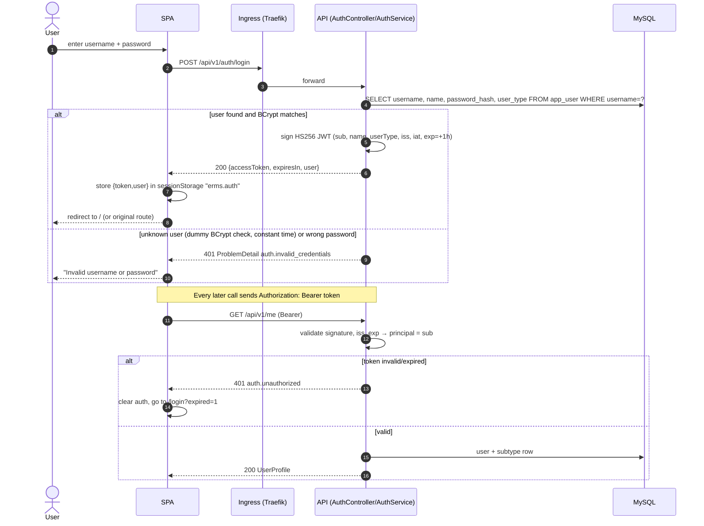
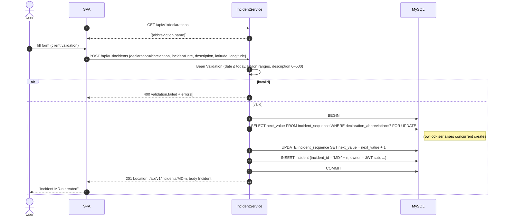
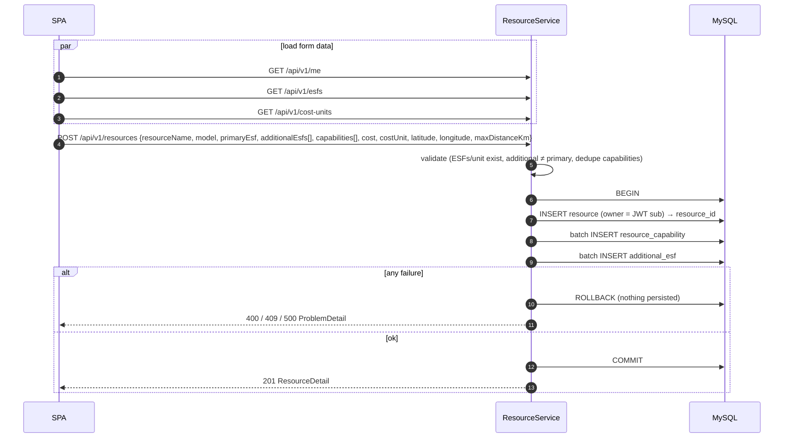
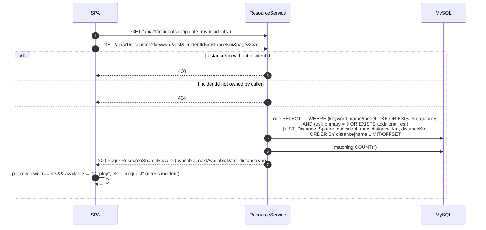
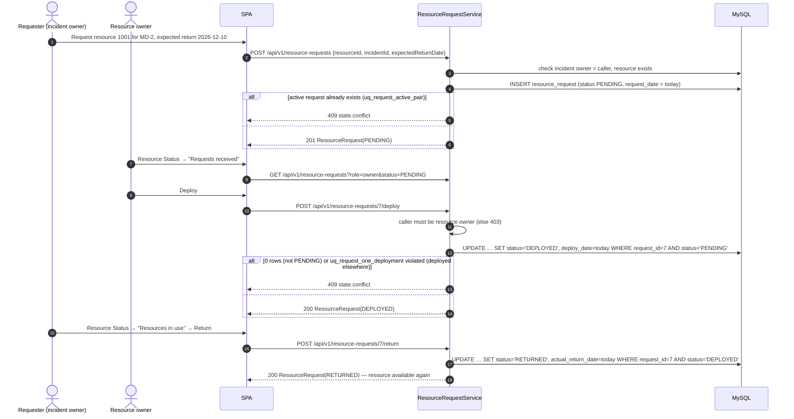
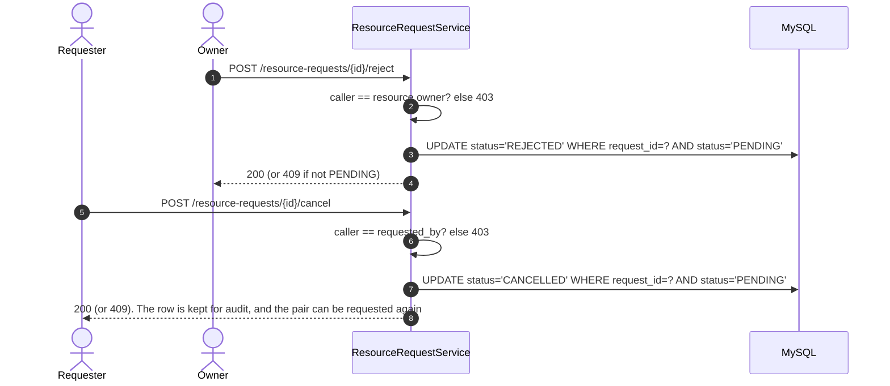
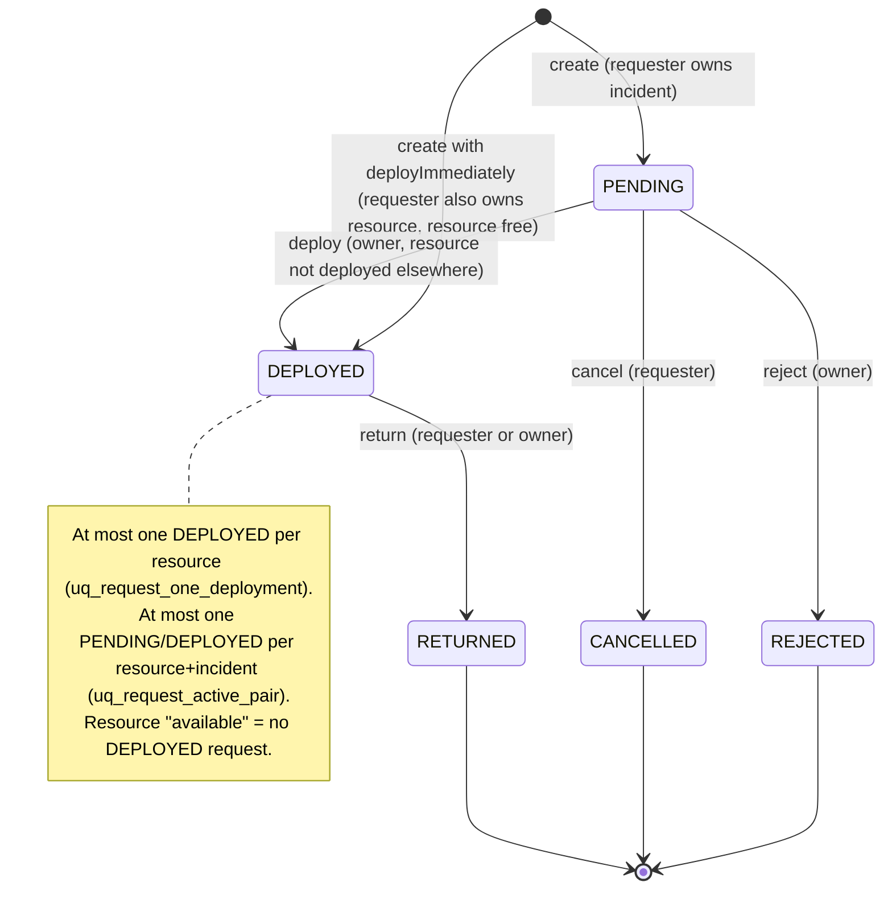
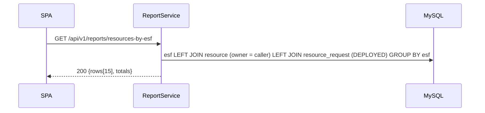

# ERMS Flows

Sequence and state diagrams for every main flow. Participants: **SPA** (React in the browser), **Ingress** (Traefik), **API** (Spring Boot), **DB** (MySQL). The Ingress is omitted after the first diagram; every `/api` call goes through it.

## Login and JWT

## Add incident (server-generated ID)

## Add resource

## Search resources

## Request → deploy → return

Owner self-deploy shortcut: when the caller owns both the resource and the incident, the SPA sends `deployImmediately: true`. The request is inserted directly as `DEPLOYED`, and the API returns 409 if the resource is already deployed.

## Reject and cancel

## Resource request lifecycle

## Report

