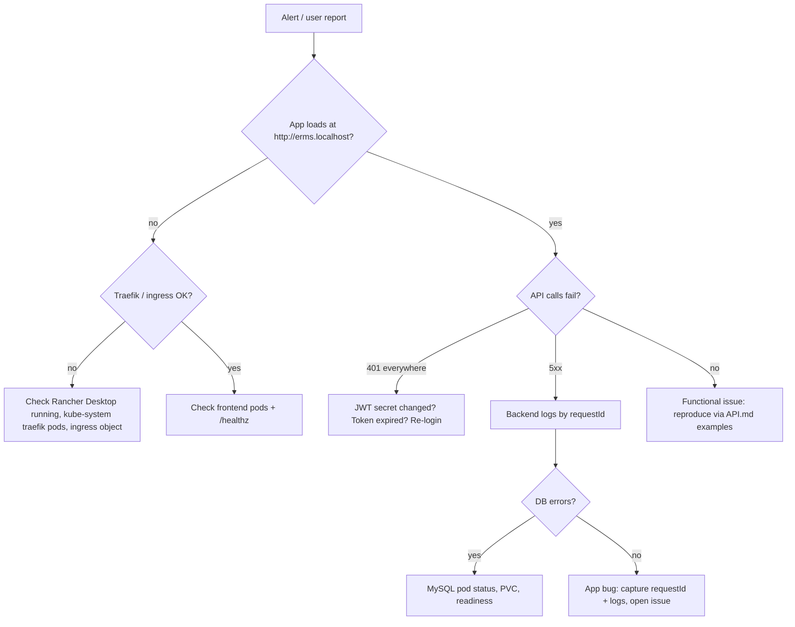

# ERMS Runbook

Operational procedures for the Rancher Desktop deployment (context `rancher-desktop`, namespace `erms`, release `erms`). Owner: WP-PLAT. Sections marked `<!-- PLAT: … -->` must be filled in with tested commands.

Shorthand used below: `K="kubectl --context rancher-desktop -n erms"`.

## Service overview
| Component | Health | Logs | Metrics |
|---|---|---|---|
| backend | `:8081/actuator/health/{liveness,readiness}` | JSON (ECS) on stdout, field `requestId` | `:8081/actuator/prometheus` |
| frontend | `:8080/healthz` | nginx access/error on stdout | – |
| mysql | `mysqladmin ping` | stdout | – |

URLs: app `http://erms.localhost` · API `http://erms.localhost/api/v1` · Swagger `http://erms.localhost/api/docs` (when enabled).

## Triage flow

## Common procedures
<!-- PLAT: fill exact commands for each item below and verify them -->
1. **Status**: `helm status erms`, `$K get pods,svc,ingress,pvc`, `$K get events --sort-by=.lastTimestamp`.
2. **Logs**: backend/frontend/mysql (`$K logs deploy/erms-backend`, `--previous` after a crash). Filter backend JSON by `requestId`.
3. **Health from inside the cluster**: `helm test erms --logs`, or port-forward `svc/erms-backend 8081` and curl readiness.
4. **Restart**: `$K rollout restart deploy/erms-backend` (and frontend); `$K rollout status …`.
5. **Scale**: `$K scale deploy/erms-backend --replicas=N` (prefer values + helm upgrade).
6. **Rollback**: see [DEPLOYMENT.md → Rollback](DEPLOYMENT.md#rollback).
7. **DB shell**: `$K exec -it erms-mysql-0 -- sh -c 'mysql -uerms -p"$MYSQL_PASSWORD" erms'`.
8. **Backup / restore (local)**: `mysqldump` via exec to a local file; restore by piping into `mysql`.
9. **Rotate JWT secret**: patch `erms-secrets.jwt-secret` → restart the backend → all users log in again.
10. **Reset local environment**: `helm uninstall erms`, delete the PVC `data-erms-mysql-0` and the secret `erms-secrets`, then redeploy.
11. **Flyway failure on startup**: read the backend logs for the failed version. Never edit applied migrations. Fix with a new migration; for local only, `flyway repair` or reset the environment.
12. **Runner issues**: status and logs of the LaunchAgent; re-run `scripts/setup-local-runner.sh`.

## Known failure modes
| Symptom | Cause | Fix |
|---|---|---|
| backend `Init:0/1` for a long time | MySQL not ready (first start initialises the data dir, about 30–60 s) | Wait; check mysql logs |
| backend CrashLoopBackOff, "ERMS_JWT_SECRET must be ≥ 32 bytes" | Secret missing or short | Check `erms-secrets`; reinstall or patch |
| `ImagePullBackOff` | sha image not in the local moby store | `docker pull ghcr.io/manojis/erms-backend:<sha>` (CD normally does this) |
| 404 from Traefik | Ingress host mismatch | Use `http://erms.localhost`; check `ingress.host` |
| All logins fail after a redeploy | DB volume recreated without the demo profile | Make sure `backend.profiles=demo` for local |
| Everything down after a Mac restart | Rancher Desktop not started | Start Rancher Desktop; pods recover automatically (PVC keeps data) |
