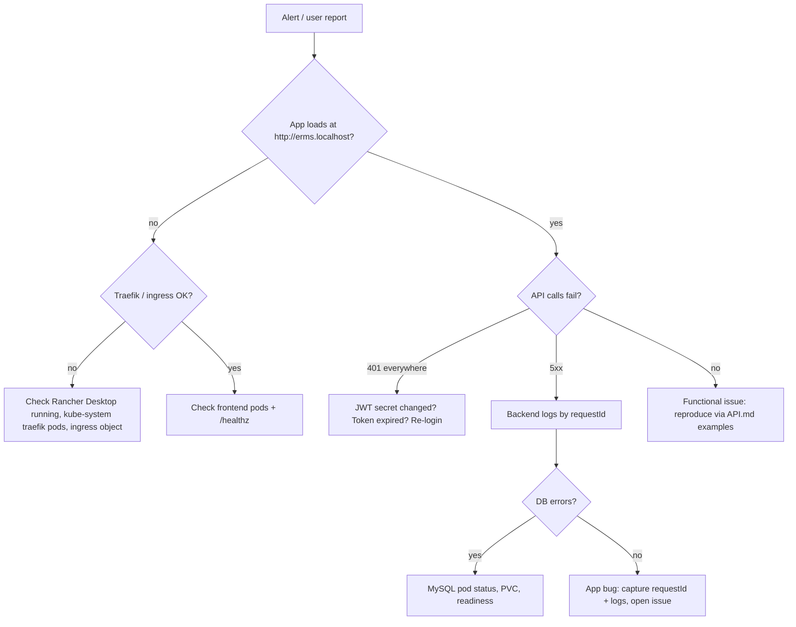

# ERMS Runbook

Operational procedures for the Rancher Desktop deployment (context `rancher-desktop`, namespace `erms`, release `erms`). Owner: WP-PLAT.

Shorthand used below. It is a shell function, so it works in both zsh (the macOS default) and bash; a `K="kubectl …"` variable would not word-split in zsh:

```bash
export PATH="$HOME/.rd/bin:$PATH"
k() { kubectl --context rancher-desktop -n erms "$@"; }
h() { helm --kube-context rancher-desktop -n erms "$@"; }
```

## Service overview
| Component | Health | Logs | Metrics |
|---|---|---|---|
| backend | `:8081/actuator/health/{liveness,readiness}` | JSON (ECS) on stdout, field `requestId` | `:8081/actuator/prometheus` |
| frontend | `:8080/healthz` | nginx access/error on stdout | – |
| mysql | `mysqladmin ping` | stdout | – |

URLs: app `http://erms.localhost` · API `http://erms.localhost/api/v1` · Swagger `http://erms.localhost/api/docs` (when enabled).

## Triage flow



## Common procedures

### 1. Status
```bash
make status                          # helm status + pods, svc, ingress, pvc
h status erms
h history erms --max 10
k get pods,deploy,sts,svc,ingress,pvc,networkpolicy -o wide
k get events --sort-by=.lastTimestamp | tail -30
scripts/diagnostics.sh               # everything above + describe of non-ready pods + logs
```

### 2. Logs
```bash
k logs deploy/erms-backend --tail=200            # add -f to follow, --previous after a crash
k logs deploy/erms-backend -c wait-for-mysql     # initContainer
k logs deploy/erms-frontend --tail=200
k logs sts/erms-mysql --tail=200
# Backend logs are ECS JSON; filter by the X-Request-Id a user reported:
k logs deploy/erms-backend --since=1h | jq -cR 'fromjson? | select(.requestId == "<request-id>")'
# Errors only:
k logs deploy/erms-backend --since=1h | jq -cR 'fromjson? | select(."log.level" == "ERROR")'
```

### 3. Health from inside the cluster
```bash
h test erms --logs                                   # curls backend :8081 readiness and frontend /healthz
k port-forward svc/erms-backend 8081:8081            # in a second terminal:
curl -s http://localhost:8081/actuator/health/readiness
curl -s http://localhost:8081/actuator/prometheus | head
scripts/smoke-test.sh http://erms.localhost          # public path through Traefik
```
The management port is never routed by the Ingress: `curl -s http://erms.localhost/actuator/health` returns the SPA's `index.html`, not actuator JSON.

### 4. Restart
```bash
k rollout restart deploy/erms-backend && k rollout status deploy/erms-backend --timeout=5m
k rollout restart deploy/erms-frontend && k rollout status deploy/erms-frontend --timeout=2m
k rollout restart sts/erms-mysql && k rollout status sts/erms-mysql --timeout=5m   # brief DB outage
```

### 5. Scale
Prefer values plus an upgrade, so the next CD run doesn't revert it (replicas > 1 also renders a PDB):
```bash
h upgrade erms deploy/helm/erms --reuse-values --set backend.replicas=2 --rollback-on-failure --wait --timeout 10m
```
Temporary only (reverted by the next deploy): `k scale deploy/erms-backend --replicas=2`.

### 6. Rollback
See [DEPLOYMENT.md → Rollback](DEPLOYMENT.md#rollback): `h history erms`, then `h rollback erms <REVISION> --wait --timeout 10m`.

### 7. DB shell
```bash
k exec -it erms-mysql-0 -- sh -c 'MYSQL_PWD="$MYSQL_PASSWORD" mysql -uerms erms'
k exec -it erms-mysql-0 -- sh -c 'MYSQL_PWD="$MYSQL_ROOT_PASSWORD" mysql -uroot'     # admin
```
`MYSQL_PWD` keeps the password off the command line; the variables come from the pod's own env (secret `erms-secrets`).

### 8. Backup / restore (local)
```bash
# Backup to a local file (consistent InnoDB snapshot)
k exec erms-mysql-0 -- sh -c 'MYSQL_PWD="$MYSQL_ROOT_PASSWORD" mysqldump -uroot --single-transaction --routines --triggers --databases erms' > erms-$(date +%Y%m%d-%H%M%S).sql

# Restore (stop the backend first so nothing writes during the import)
k scale deploy/erms-backend --replicas=0
k exec -i erms-mysql-0 -- sh -c 'MYSQL_PWD="$MYSQL_ROOT_PASSWORD" mysql -uroot' < erms-YYYYMMDD-HHMMSS.sql
k scale deploy/erms-backend --replicas=1
```

### 9. Rotate secrets
JWT secret (all users must log in again):
```bash
NEW_JWT="$(openssl rand -base64 64 | tr -dc 'A-Za-z0-9' | head -c 48)"
k patch secret erms-secrets --type merge -p "{\"stringData\":{\"jwt-secret\":\"${NEW_JWT}\"}}"
k rollout restart deploy/erms-backend && k rollout status deploy/erms-backend --timeout=5m
unset NEW_JWT
```
The chart's `lookup` keeps the patched value on later upgrades. MySQL app password (the DB user must change first, then the secret):
```bash
NEW_PW="$(openssl rand -base64 48 | tr -dc 'A-Za-z0-9' | head -c 24)"
k exec erms-mysql-0 -- sh -c "MYSQL_PWD=\"\$MYSQL_ROOT_PASSWORD\" mysql -uroot -e \"ALTER USER 'erms'@'%' IDENTIFIED BY '${NEW_PW}'\""
k patch secret erms-secrets --type merge -p "{\"stringData\":{\"mysql-password\":\"${NEW_PW}\"}}"
k rollout restart deploy/erms-backend && k rollout status deploy/erms-backend --timeout=5m
unset NEW_PW
```

### 10. Reset the local environment (deletes all data)
```bash
h uninstall erms --wait
k delete pvc data-erms-mysql-0
k delete secret erms-secrets
make deploy-local                     # or re-run the CD workflow
```
Always delete the PVC and the secret together: MySQL only applies `MYSQL_PASSWORD` when it initialises an empty data directory.

### 11. Flyway failure on startup
```bash
k logs deploy/erms-backend --previous | jq -cR 'fromjson? | select(.message | test("(?i)flyway|migration"))'
k exec -it erms-mysql-0 -- sh -c 'MYSQL_PWD="$MYSQL_PASSWORD" mysql -uerms erms -e "SELECT installed_rank, version, description, success FROM flyway_schema_history ORDER BY installed_rank"'
```
Never edit an applied migration; fix forward with a new `V<n>__…sql`. Local only: delete the failed row (`DELETE FROM flyway_schema_history WHERE success = 0;`) after repairing the schema by hand, or reset the environment (procedure 10).

### 12. Runner issues
```bash
make runner-status                                              # LaunchDaemon state + GitHub online/busy
make runner-stop && make runner-start                           # restart (sudo)
sudo tail -n 100 /Library/Logs/erms-runner/stderr.log           # service stdout/stderr
sudo sh -c 'tail -n 100 /opt/erms-runner/runner/_diag/Runner_*.log'   # runner diagnostics
gh run list --workflow cd.yml -L5                               # "waiting" = needs your approval (docs/CICD.md)
make runner-setup                                               # idempotent repair (tools, kubeconfig, .path/.env, service)
```

### 13. Verify the NetworkPolicy (QA)
A throwaway pod without the backend label must not reach MySQL. The namespace enforces Pod Security `restricted`, so the pod needs a compliant spec:
```bash
k run np-probe --rm -i --restart=Never --image=busybox:1.37.0 --overrides='{"apiVersion":"v1","spec":{"securityContext":{"runAsNonRoot":true,"runAsUser":65534,"seccompProfile":{"type":"RuntimeDefault"}},"containers":[{"name":"np-probe","image":"busybox:1.37.0","command":["sh","-c","if nc -z -w 3 erms-mysql 3306; then echo REACHABLE; else echo BLOCKED; fi"],"securityContext":{"allowPrivilegeEscalation":false,"capabilities":{"drop":["ALL"]}}}]}}'
# expect: BLOCKED
```

## Known failure modes
| Symptom | Cause | Fix |
|---|---|---|
| backend `Init:0/1` for a long time | MySQL not ready (first start initialises the data dir, about 30–60 s) | Wait; check mysql logs |
| backend CrashLoopBackOff, "ERMS_JWT_SECRET must be ≥ 32 bytes" | Secret missing or short | Check `erms-secrets`; reinstall or patch |
| `ImagePullBackOff` | sha not on GHCR (images job failed), a GHCR package made private, or a `local-…` tag missing from the local moby store | Check the CI images job; keep the packages public; `make deploy-local` for local tags |
| 404 from Traefik | Release not installed, or Ingress host mismatch | `k get ingress erms`; use `http://erms.localhost`; check `ingress.host` |
| All logins fail after a redeploy | DB volume recreated without the demo profile | Make sure `backend.profiles=demo` for local |
| Everything down after a Mac restart | Rancher Desktop not started | Start Rancher Desktop; pods recover automatically (PVC keeps data) |
| Pods rejected with `violates PodSecurity "restricted"` | A manual `kubectl run`/debug pod without a restricted securityContext | Use a compliant spec (see procedure 13) |
| backend `CrashLoopBackOff` with `Access denied for user 'erms'` | `erms-secrets` was deleted/recreated but the PVC kept the old password | Restore the old secret, or reset the environment (procedure 10) |
| `helm upgrade` fails with `another operation (install/upgrade/rollback) is in progress` | A previous run was interrupted | `h history erms`; `h rollback erms <last deployed revision>` |
