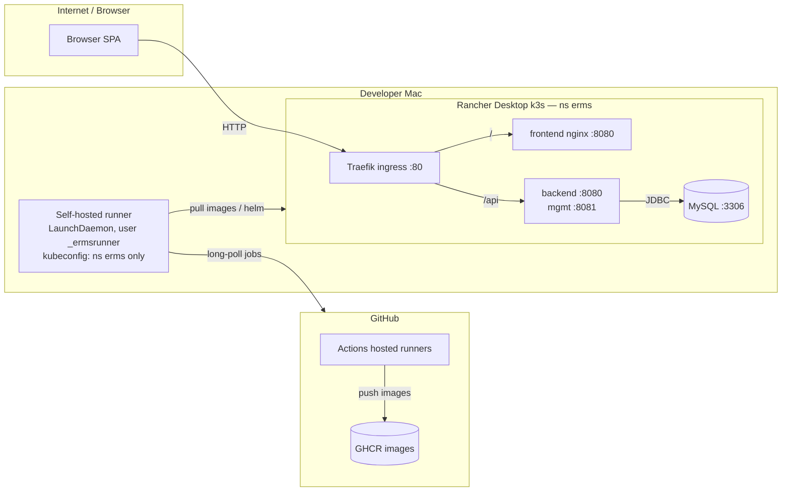

# ERMS Security

## Scope & assets
| Asset | Why it matters |
|---|---|
| User credentials | Account takeover |
| JWT signing secret | Lets an attacker forge any identity |
| Incident and resource data | Operational data; includes locations |
| Request workflow integrity | Wrong deployments during an emergency |
| CI/CD and the self-hosted runner | Code execution on the developer Mac; a supply-chain foothold |

## Trust boundaries

## Threat model (STRIDE summary)
| Threat | Example | Mitigation |
|---|---|---|
| **S**poofing | Forged identity via a username param (legacy IDOR) | JWT `sub` only; HS256 secret ≥ 256 bit; `iss`/`exp` validated |
| **T**ampering | Client sets request status / incident ID | Server-side state machine, server-generated IDs, DB unique/check constraints |
| **R**epudiation | Who deployed or cancelled? | Requests never deleted; `created_at/updated_at`; structured logs with requestId and user |
| **I**nformation disclosure | Stack traces, password logging, other users' incidents | Generic 500s; no credential logging; per-record visibility (404); management port internal |
| **D**enial of service | Unbounded search | Pagination (max 100); Hikari pool limits; resource limits in k8s. *Gap:* no login rate limit (future: ingress middleware or bucket4j) |
| **E**levation of privilege | Fork PR runs code on the self-hosted runner | Runner used only by `cd.yml` (workflow_run from a main push of this repo + workflow_dispatch); fork-PR approval required; environment `local` limited to main |

## OWASP Top 10 (2021) mapping
See [ARCHITECTURE.md §7](ARCHITECTURE.md#7-security-baseline-owasp-top-10-2021-mapping). Summary: access control by ownership (A01), BCrypt + secret management (A02), parameterised SQL + LIKE escaping + CSP (A03), DB-enforced invariants (A04), hardened containers, NetworkPolicies, docs off by default (A05), Dependabot + Trivy + CodeQL (A06), generic auth errors + short-lived tokens (A07), sha-pinned images + SBOM/provenance (A08), JSON logs + metrics + audit trail (A09), no user-driven outbound calls (A10).

## Secrets handling
| Secret | Where it lives | How it's created | Rotation |
|---|---|---|---|
| MySQL root and app passwords | k8s Secret `erms-secrets` (`mysql-root-password`, `mysql-password`) | Helm generates random values on first install (`randAlphaNum 24`), reuses them on every upgrade via `lookup`, `helm.sh/resource-policy: keep` | App password: `ALTER USER`, patch the secret, restart the backend ([RUNBOOK](RUNBOOK.md#9-rotate-secrets)). Local reset: delete the secret **and** the PVC together. Production: `secrets.existingSecret` |
| JWT secret | `erms-secrets.jwt-secret` | Same as above (`randAlphaNum 48`) | Patch the secret, then `kubectl rollout restart deploy/erms-backend` (existing tokens become invalid) ([RUNBOOK](RUNBOOK.md#9-rotate-secrets)) |
| External secret (production) | Any Secret named by `secrets.existingSecret` with the same three keys | Created out of band (e.g. External Secrets Operator / Sealed Secrets) | Owner's process; the chart then renders no Secret |
| GHCR auth (CI push) | `GITHUB_TOKEN`, job-scoped (`packages: write` only on the CI `images` job) | Provided by Actions | Automatic (expires with the job). CD needs no registry credentials: the packages are public and k3s pulls them anonymously |
| Runner registration / removal token | Not stored | `gh api -X POST repos/…/actions/runners/{registration,remove}-token` at setup/uninstall (1 h validity), unset after use | n/a |
| Runner credentials | `/opt/erms-runner/runner/.credentials*` (owned by `_ermsrunner`, directory mode 700) | Written by `config.sh` | `make runner-uninstall && make runner-setup` |
| Runner kubeconfig (ServiceAccount token, namespace `erms` only) | `/opt/erms-runner/home/.kube/config` (`_ermsrunner`, mode 600); source Secret `erms/erms-deployer-token` | `make runner-setup` | `kubectl --context rancher-desktop -n erms delete secret erms-deployer-token && make runner-setup` |
| docker-compose dev values | `docker-compose.yml` | Literal `change-me-dev-…` placeholders, labelled **DEV ONLY** | n/a (never used outside compose) |

Rules: no secrets in git, images or ConfigMaps (the backend ConfigMap holds only non-secret settings; passwords and the JWT key are `secretKeyRef`s); `.env*`, keys and kubeconfigs are gitignored; Trivy secret scanning runs in CI; GitHub secret scanning and push protection are enabled by `scripts/setup-local-runner.sh`. `helm template` and client-side dry-runs can't `lookup`, so they print fresh random values. Never apply their output over a live release.

## Container & cluster hardening
| Control | Where |
|---|---|
| Non-root UIDs: backend 10001, frontend 10101, mysql 999, helm test 100; `runAsNonRoot: true` | Pod `securityContext` |
| `readOnlyRootFilesystem: true` for backend (emptyDir `/tmp`), frontend (emptyDirs `/tmp`, `/var/cache/nginx`, `/etc/nginx/conf.d`), mysql (emptyDirs `/var/run/mysqld`, `/tmp`; toggle `mysql.readOnlyRootFilesystem`), initContainer and test pod | Container `securityContext` |
| `allowPrivilegeEscalation: false`, `privileged: false`, `capabilities.drop: [ALL]`, `seccompProfile: RuntimeDefault` | Every container, including initContainers and the test pod |
| Namespace `erms` enforces Pod Security Standard **restricted** (`pod-security.kubernetes.io/enforce=restricted`) | Set by `cd.yml` and `deploy-local.sh`; the chart passes a server-side dry-run under it |
| Dedicated ServiceAccount, `automountServiceAccountToken: false` (SA and pods), `enableServiceLinks: false` | All pods |
| NetworkPolicies: mysql:3306 only from backend pods; backend:8080 from the ingress-controller namespace (`kube-system`) and frontend pods; backend 8080/8081 and frontend 8080 from `helm test` pods (`app.kubernetes.io/component: test`); frontend:8080 from the ingress-controller namespace | `templates/networkpolicy.yaml` (k3s enforces them with its embedded controller) |
| Management port 8081 is never routed by the Ingress; the smoke test asserts actuator health isn't public | Ingress + `smoke-test.sh` |
| Resource requests and memory limits on every container; emptyDir `sizeLimit`s | values |
| Images: application images by immutable git-sha tag; third-party images pinned by exact version (`mysql:26.10.0.1`, `busybox:1.38.0`, `curlimages/curl:8.23.0`); Dependabot (docker, helm, docker-compose ecosystems) bumps them | values, compose |
| docker-compose: ports bound to `127.0.0.1`, `read_only`, `cap_drop: [ALL]`, `no-new-privileges` for backend and frontend | `docker-compose.yml` |

### CI/CD and runner hardening
- All third-party actions pinned to full commit SHAs; top-level `permissions: contents: read`, with elevated scopes only on the jobs that need them; `persist-credentials: false` on every checkout.
- Images published only on push to `main`, multi-arch, with SBOM and `provenance: mode=max`; Trivy fs and image scans gate on CRITICAL, and SARIF goes to code scanning; CodeQL covers Java, TypeScript and the workflows themselves (`actions`).
- The self-hosted runner is used **only** by `cd.yml` (`workflow_run` from a successful CI **push** on `main` of this repository, or `workflow_dispatch` on `main`); CI fails if any workflow combines `self-hosted` with a `pull_request` trigger.
- Repository settings applied by `scripts/setup-local-runner.sh`: environment `local` limited to `main`, with the repository owner as required reviewer (every deployment waits for approval); fork-PR workflow approval for all external contributors; default `GITHUB_TOKEN` read-only and unable to approve PRs; secret scanning + push protection.
- The runner runs as the hidden, unprivileged macOS user `_ermsrunner` (no password, no login shell, not an admin) from a system LaunchDaemon, never as your account or root. It cannot read your home directory, has **no access to the Rancher Desktop docker socket** (root-equivalent in the VM), and its kubeconfig is the ServiceAccount `erms/erms-deployer`, which can only manage the chart's resources in namespace `erms` (no cluster-scoped resources, RBAC, `pods/exec` or other namespaces; verified with `kubectl auth can-i` at setup). Its `kubectl`/`helm` are root-owned and its `.path` is fixed. The runner download and `kubectl` are SHA-256 verified. The runner keeps auto-updating.
- `make runner-stop` stops and disables the service (it stays off across reboots) and `make runner-start` turns it back on, so the runner only exists while you want deployments.
- Residual risk: an approved job can still use the network as `_ermsrunner`, read world-readable files on the Mac, and change or delete the ERMS release and its data in namespace `erms`. Approve only runs whose commit you recognise on `main`.

## HTTP security headers (frontend nginx)
`Content-Security-Policy` (self only; inline styles allowed for MUI/emotion), `X-Content-Type-Options: nosniff`, `X-Frame-Options: DENY`, `Referrer-Policy: strict-origin-when-cross-origin`, `Permissions-Policy`, `server_tokens off`.

## Known limitations / accepted risks (local environment)
- No TLS on `erms.localhost` (loopback only). Production should terminate TLS at the ingress (cert-manager).
- No login rate limiting or lockout.
- The token lives in sessionStorage (XSS-exposed if CSP is bypassed). A future option is an httpOnly cookie + CSRF.
- Single MySQL instance with no backups.

## Reporting a vulnerability
Open a private security advisory on the GitHub repository (Security → Advisories). Do not file public issues for vulnerabilities.
