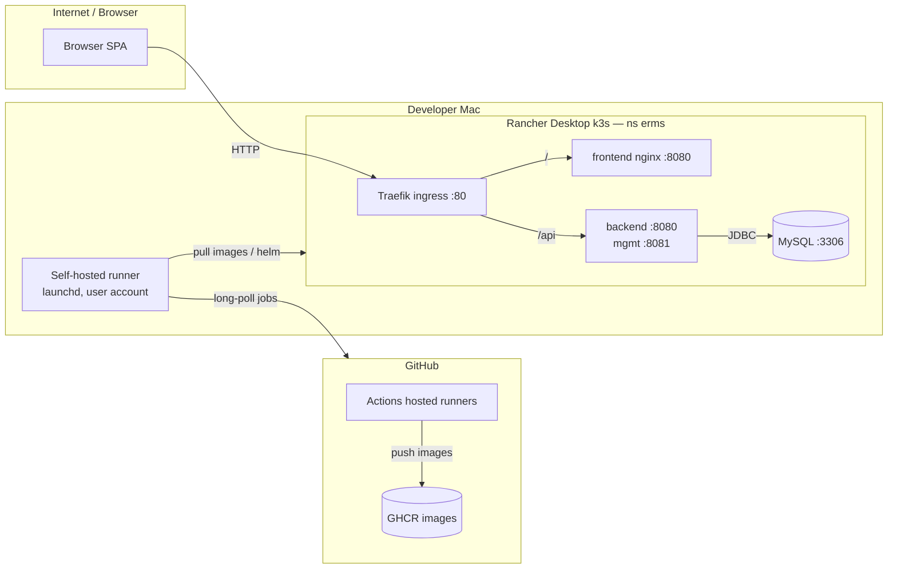

# ERMS Security

## Scope & assets
| Asset | Why it matters |
|---|---|
| User credentials | Account takeover |
| JWT signing secret | Lets an attacker forge any identity |
| Incident and resource data | Operational data; includes locations |
| Request workflow integrity | Wrong deployments during an emergency |
| CI/CD and the self-hosted runner | Code execution on the developer Mac; a supply-chain foothold |

## Trust boundaries

## Threat model (STRIDE summary)
| Threat | Example | Mitigation |
|---|---|---|
| **S**poofing | Forged identity via a username param (legacy IDOR) | JWT `sub` only; HS256 secret ≥ 256 bit; `iss`/`exp` validated |
| **T**ampering | Client sets request status / incident ID | Server-side state machine, server-generated IDs, DB unique/check constraints |
| **R**epudiation | Who deployed or cancelled? | Requests never deleted; `created_at/updated_at`; structured logs with requestId and user |
| **I**nformation disclosure | Stack traces, password logging, other users' incidents | Generic 500s; no credential logging; per-record visibility (404); management port internal |
| **D**enial of service | Unbounded search | Pagination (max 100); Hikari pool limits; resource limits in k8s. *Gap:* no login rate limit (future: ingress middleware or bucket4j) |
| **E**levation of privilege | Fork PR runs code on the self-hosted runner | Runner used only by `cd.yml` (workflow_run from a master push of this repo + workflow_dispatch); fork-PR approval required; environment `local` limited to master |

## OWASP Top 10 (2021) mapping
See [ARCHITECTURE.md §7](ARCHITECTURE.md#7-security-baseline-owasp-top-10-2021-mapping). Summary: access control by ownership (A01), BCrypt + secret management (A02), parameterised SQL + LIKE escaping + CSP (A03), DB-enforced invariants (A04), hardened containers, NetworkPolicies, docs off by default (A05), Dependabot + Trivy + CodeQL (A06), generic auth errors + short-lived tokens (A07), sha-pinned images + SBOM/provenance (A08), JSON logs + metrics + audit trail (A09), no user-driven outbound calls (A10).

## Secrets handling
| Secret | Where it lives | How it's created | Rotation |
|---|---|---|---|
| MySQL root and app passwords | k8s Secret `erms-secrets` (`mysql-root-password`, `mysql-password`) | Helm generates random values on first install, reuses them via `lookup`, `resource-policy: keep` | Delete the secret + PVC (local) or provide `secrets.existingSecret` |
| JWT secret | `erms-secrets.jwt-secret` | Same as above (48 random chars) | Patch the secret, then `kubectl rollout restart deploy/erms-backend` (existing tokens become invalid) |
| GHCR auth (CD) | `GITHUB_TOKEN`, job-scoped | Provided by Actions | Automatic |
| Runner registration token | Not stored | `gh api …/registration-token` at setup (1 h validity) | n/a |
| docker-compose dev values | `docker-compose.yml` | Literal `change-me-…` placeholders, dev only | n/a |

Rules: no secrets in git, images or ConfigMaps; `.env*` is gitignored; Trivy secret scanning runs in CI; GitHub secret scanning and push protection should be enabled on the repo.

## Container & cluster hardening
Non-root UIDs (backend 10001, frontend 101, mysql 999); `readOnlyRootFilesystem` for backend and frontend; `allowPrivilegeEscalation: false`; drop ALL capabilities; `seccompProfile: RuntimeDefault`; no service-account token automount; NetworkPolicies (mysql only from backend; apps only from the ingress namespace); resource requests and limits; images pinned by git-sha tag.

## HTTP security headers (frontend nginx)
`Content-Security-Policy` (self only; inline styles allowed for MUI/emotion), `X-Content-Type-Options: nosniff`, `X-Frame-Options: DENY`, `Referrer-Policy: strict-origin-when-cross-origin`, `Permissions-Policy`, `server_tokens off`.

## Known limitations / accepted risks (local environment)
- No TLS on `erms.localhost` (loopback only). Production should terminate TLS at the ingress (cert-manager).
- No login rate limiting or lockout.
- The token lives in sessionStorage (XSS-exposed if CSP is bypassed). A future option is an httpOnly cookie + CSRF.
- Single MySQL instance with no backups.

## Reporting a vulnerability
Open a private security advisory on the GitHub repository (Security → Advisories). Do not file public issues for vulnerabilities.
