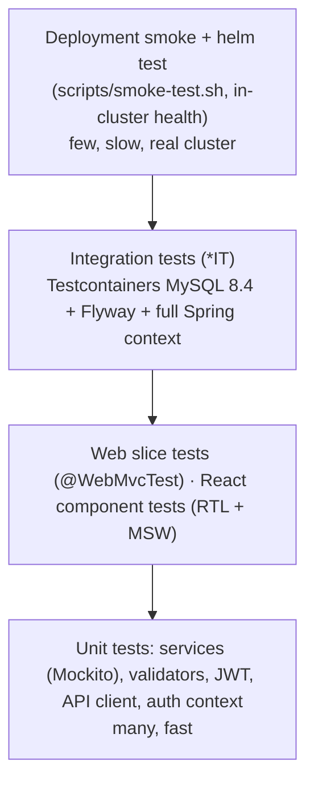

# ERMS Testing Strategy

## Pyramid



## What each layer covers
| Layer | Tooling | Covers | Location |
|---|---|---|---|
| Backend unit | JUnit 5, Mockito, AssertJ | Service rules: state transitions, authorization (owner/requester), validation edge cases, incident id formatting, `Clock`-based dates, JWT issue/verify, LIKE escaping | `backend/src/test/java/**/*Test.java` |
| Backend web slice | `@WebMvcTest`, spring-security-test | HTTP status codes, ProblemDetail shape (`code`, `requestId`, `errors[]`), 401 without token, request binding/validation, JSON field names | `**/*ControllerTest.java` |
| Backend integration | Testcontainers `mysql:8.4`, `@SpringBootTest`, `@ServiceConnection` | Flyway migrations apply; every repository SQL; search semantics (F1–F6); report (F10); full request lifecycle + DB constraints (F12–F18); 10-thread incident id concurrency (F8); transactional rollback (R6); login end-to-end | `**/*IT.java` |
| Frontend unit/component | Vitest 5, React Testing Library, user-event, MSW 2, jsdom | Validators (pure functions); session storage + JWT `exp`; AuthContext persist/expire/logout/401; ProtectedRoute; API client (Bearer header, 401 interceptor, ProblemDetail normalisation, query serialisation); `useApiData`; every page through the real route table with MSW (see [Frontend suite](#frontend-suite)) | `frontend/src/**/*.test.ts(x)` |
| Static | Spotless, ESLint, Prettier, tsc, hadolint, actionlint, shellcheck, helm lint, kubeconform | Style, types, Dockerfile/workflow/script/chart correctness | CI jobs |
| Security | Trivy (fs, image, misconfig, secrets), CodeQL, Dependabot | Vulnerable deps, IaC misconfig, leaked secrets, code-level vulns | CI |
| Deployment | `helm test`, `scripts/smoke-test.sh` | Pods ready, ingress routing, login → `/me` → reference data, 401 without token | CD job |

Every **T**-marked legacy defect in [ARCHITECTURE.md §6](ARCHITECTURE.md#6-legacy-defects-required-fixes-and-regression-tests) has at least one named regression test. Name tests after the defect where practical (e.g. `keywordSearch_findsResourceWithoutCapabilities_F1`).

## Coverage gates
| Component | Gate | Tool |
|---|---|---|
| Backend `service` + `repository` | ≥ 80% lines | JaCoCo (unit + IT merged), fails `verify` |
| Backend overall bundle | ≥ 70% lines | JaCoCo |
| Frontend | ≥ 70% lines required; `vitest.config.ts` enforces lines/statements/functions ≥ 85%, branches ≥ 80% (current: ~99% lines, ~95% branches) | Vitest v8 coverage thresholds, fails `npm run test:coverage` |

## Running tests
```bash
# Backend (needs Docker for Testcontainers). On Rancher Desktop:
export DOCKER_HOST=unix://$HOME/.rd/docker.sock
export TESTCONTAINERS_DOCKER_SOCKET_OVERRIDE=/var/run/docker.sock
cd backend && ./mvnw -B verify            # unit + IT + spotless + jacoco
./mvnw -B test                            # unit + slice only (fast)
./mvnw spotless:apply                     # auto-format

# Frontend (Node 24+; Vitest + MSW, no backend needed)
cd frontend && npm ci
npm run lint && npm run format:check && npm run typecheck && npm run test:coverage && npm run build
npm run test:watch                        # watch mode while developing

# Everything via Makefile
make be-test fe-test helm-lint

# Against a deployed stack
scripts/smoke-test.sh http://erms.localhost
helm test erms -n erms --kube-context rancher-desktop --logs
```

Makefile targets (`make help` lists them all):

| Target | Runs |
|---|---|
| `make be-test` | `cd backend && ./mvnw -B -ntp verify`, with `DOCKER_HOST`/`TESTCONTAINERS_DOCKER_SOCKET_OVERRIDE` set automatically when `~/.rd/docker.sock` exists |
| `make be-lint` / `make be-format` | `./mvnw spotless:check` / `spotless:apply` |
| `make fe-test` | `npm ci`, then `lint`, `format:check`, `typecheck`, `test:coverage` |
| `make fe-lint` / `make fe-format` | `lint` + `format:check` + `typecheck` / `format` |
| `make test` | `be-test` + `fe-test` |
| `make helm-lint` | `helm lint --strict` (local and default values) + `helm template … \| kubeconform -strict -summary -kubernetes-version 1.36.0` |
| `make sh-lint` / `make actions-lint` / `make docker-lint` | shellcheck `scripts/*.sh` / actionlint / hadolint on both Dockerfiles (all via pinned containers) |
| `make lint` | every lint target above |
| `make smoke` | `scripts/smoke-test.sh $(BASE_URL)` (default `http://erms.localhost`; compose: `make smoke BASE_URL=http://localhost:3000`) |

`scripts/smoke-test.sh` retries with exponential backoff (up to `SMOKE_TIMEOUT`, default 60 s) and checks: `GET /` serves the SPA shell, `POST /api/v1/auth/login` as `alice`/`password` returns an `accessToken`, `GET /api/v1/me` returns `alice`, `GET /api/v1/esfs` returns 15 items, `GET /api/v1/me` without a token returns 401, and actuator health is not exposed through the public entry point. Override the user with `SMOKE_USER`/`SMOKE_PASSWORD`.

## Frontend suite
All frontend tests run in jsdom with [MSW](https://mswjs.io) intercepting the SPA's real same-origin `/api/v1/...` calls, so the axios client, interceptors and ProblemDetail handling are exercised exactly as in production. `onUnhandledRequest: 'error'` makes any request without a handler fail the test.

| File | What it proves |
|---|---|
| `src/validation/*.test.ts`, `src/utils/utils.test.ts` | Ported legacy rules as pure functions (incident, resource, capability, return date, search distance, login), boundaries inclusive, payload conversion (lat/lon not swapped, F7), formatting (cost, distance, "In use until …", profile subtitle per user type) |
| `src/auth/session.test.ts` | `erms.auth` persistence, JWT `exp` decoding, expired/corrupt entries dropped on load |
| `src/auth/AuthContext.test.tsx` | login persists; restore on load; expired token ignored; logout → `/login`; any 401 → `/login?expired=1`; local expiry timer |
| `src/auth/ProtectedRoute.test.tsx`, `src/App.test.tsx` | Every protected route redirects to `/login`; 404 page; app bar shows name + user type |
| `src/api/client.test.ts`, `src/api/errors.test.ts` | Bearer header only with a session; 401 handler not triggered by a failed login; ProblemDetail → `ApiError` (`code`, `requestId`, `fieldErrors`); network/timeout errors; query-string serialisation |
| `src/hooks/useApiData.test.tsx` | Loading/error/reload states, stale data kept on refresh, abort on unmount |
| `src/features/login/LoginPage.test.tsx` | Success + redirect (incl. back to the originally requested page), generic 401 message, required fields, masked password, "Session expired" banner |
| `src/features/menu/MainMenuPage.test.tsx` | `/me` profile, subtitle per user type, links to all five functions, error + retry, logout |
| `src/features/incidents/AddIncidentPage.test.tsx` | Payload, server-generated id + search link, date defaults to today with `max`, client validation, server field errors mapped onto inputs |
| `src/features/resources/AddResourcePage.test.tsx` | Owner read-only, full payload, primary ESF removed from additional ESFs, capability chips (dedupe, remove), server field errors incl. `capabilities[0]` |
| `src/features/resources/SearchResourcesPage.test.tsx` | Request-vs-Deploy rule, `deployImmediately` flag, return-date validation, 409 shown in dialog, filters → query params, distance requires incident, pagination, empty and error states |
| `src/features/requests/ResourceStatusPage.test.tsx` | The three tables use the right `role`/`status` queries; Return/Cancel/Deploy/Reject call the right endpoint and refresh all tables; Deploy disabled unless `resourceAvailable`; 409 message; empty and per-table error states |
| `src/features/reports/ResourceReportPage.test.tsx` | 15 rows + totals, no-resources hint, error state |

## Test data
- Integration tests create their own data per test. Use unique usernames/IDs, or truncate tables in `@BeforeEach`. Never depend on the demo seed.
- The `demo` seed ([DATA_MODEL.md → Demo seed](DATA_MODEL.md)) is for manual QA and smoke tests only.

## QA process
The QA agent runs the checklist in [WORK_PACKAGES.md](WORK_PACKAGES.md#qa-checklist), files findings as `[BLOCKER|MAJOR|MINOR] <ID> <file:line> <what> <expected>`, and verifies the docs match the implementation. Release gate: zero BLOCKER/MAJOR findings and every CI job green.
