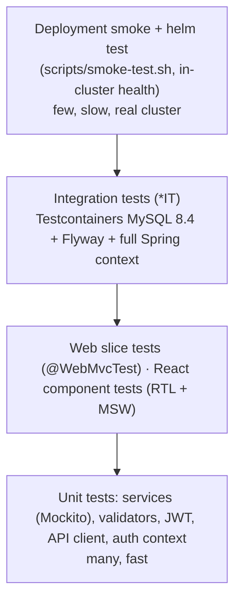

# ERMS Testing Strategy

## Pyramid



## What each layer covers
| Layer | Tooling | Covers | Location |
|---|---|---|---|
| Backend unit | JUnit 5, Mockito, AssertJ | Service rules: state transitions, authorization (owner/requester), validation edge cases, incident id formatting, `Clock`-based dates, JWT issue/verify, LIKE escaping | `backend/src/test/java/**/*Test.java` |
| Backend web slice | `@WebMvcTest`, spring-security-test | HTTP status codes, ProblemDetail shape (`code`, `requestId`, `errors[]`), 401 without token, request binding/validation, JSON field names | `**/*ControllerTest.java` |
| Backend integration | Testcontainers `mysql:8.4`, `@SpringBootTest`, `@ServiceConnection` | Flyway migrations apply; every repository SQL; search semantics (F1–F6); report (F10); full request lifecycle + DB constraints (F12–F18); 10-thread incident id concurrency (F8); transactional rollback (R6); login end-to-end | `**/*IT.java` |
| Frontend unit/component | Vitest, React Testing Library, user-event, MSW 2, jsdom | Validators; AuthContext persist/expire/logout; ProtectedRoute; API client 401 interceptor + ProblemDetail normalisation; LoginPage; Search Request-vs-Deploy logic; ResourceStatus actions call the right endpoints | `frontend/src/**/*.test.ts(x)` |
| Static | Spotless, ESLint, Prettier, tsc, hadolint, actionlint, shellcheck, helm lint, kubeconform | Style, types, Dockerfile/workflow/script/chart correctness | CI jobs |
| Security | Trivy (fs, image, misconfig, secrets), CodeQL, Dependabot | Vulnerable deps, IaC misconfig, leaked secrets, code-level vulns | CI |
| Deployment | `helm test`, `scripts/smoke-test.sh` | Pods ready, ingress routing, login → `/me` → reference data, 401 without token | CD job |

Every **T**-marked legacy defect in [ARCHITECTURE.md §6](ARCHITECTURE.md#6-legacy-defects-required-fixes-and-regression-tests) has at least one named regression test. Name tests after the defect where practical (e.g. `keywordSearch_findsResourceWithoutCapabilities_F1`).

## Coverage gates
| Component | Gate | Tool |
|---|---|---|
| Backend `service` + `repository` | ≥ 80% lines | JaCoCo (unit + IT merged), fails `verify` |
| Backend overall bundle | ≥ 70% lines | JaCoCo |
| Frontend | ≥ 70% lines | Vitest v8 coverage thresholds |

## Running tests
```bash
# Backend (needs Docker for Testcontainers). On Rancher Desktop:
export DOCKER_HOST=unix://$HOME/.rd/docker.sock
export TESTCONTAINERS_DOCKER_SOCKET_OVERRIDE=/var/run/docker.sock
cd backend && ./mvnw -B verify            # unit + IT + spotless + jacoco
./mvnw -B test                            # unit + slice only (fast)
./mvnw spotless:apply                     # auto-format

# Frontend
cd frontend && npm ci
npm run lint && npm run typecheck && npm run test:coverage

# Everything via Makefile
make be-test fe-test helm-lint

# Against a deployed stack
scripts/smoke-test.sh http://erms.localhost
helm test erms -n erms --kube-context rancher-desktop --logs
```
<!-- PLAT: confirm Makefile target names after implementation -->

## Test data
- Integration tests create their own data per test. Use unique usernames/IDs, or truncate tables in `@BeforeEach`. Never depend on the demo seed.
- The `demo` seed ([DATA_MODEL.md → Demo seed](DATA_MODEL.md)) is for manual QA and smoke tests only.

## QA process
The QA agent runs the checklist in [WORK_PACKAGES.md](WORK_PACKAGES.md#qa-checklist), files findings as `[BLOCKER|MAJOR|MINOR] <ID> <file:line> <what> <expected>`, and verifies the docs match the implementation. Release gate: zero BLOCKER/MAJOR findings and every CI job green.
